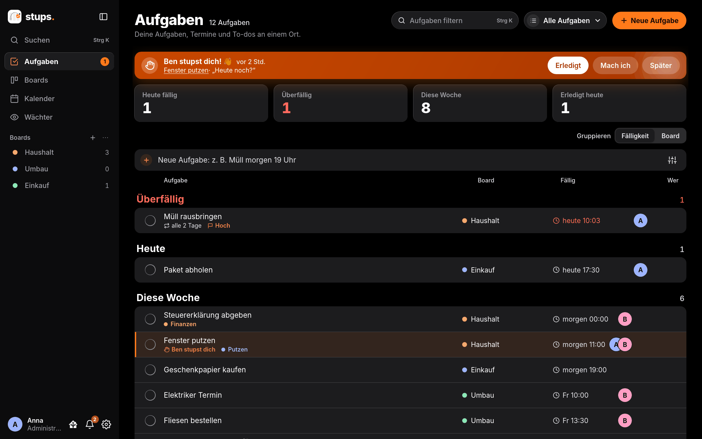
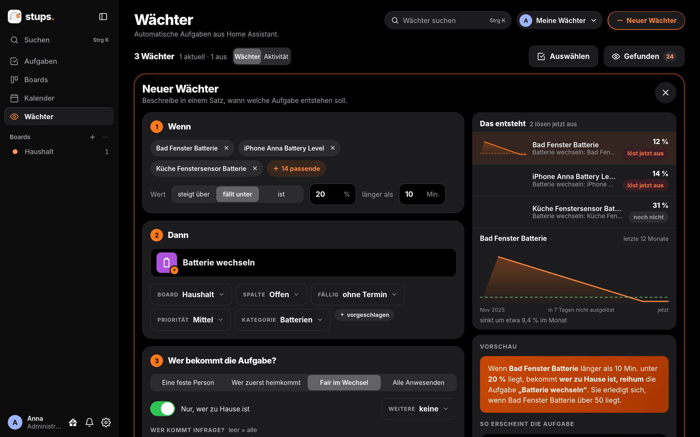
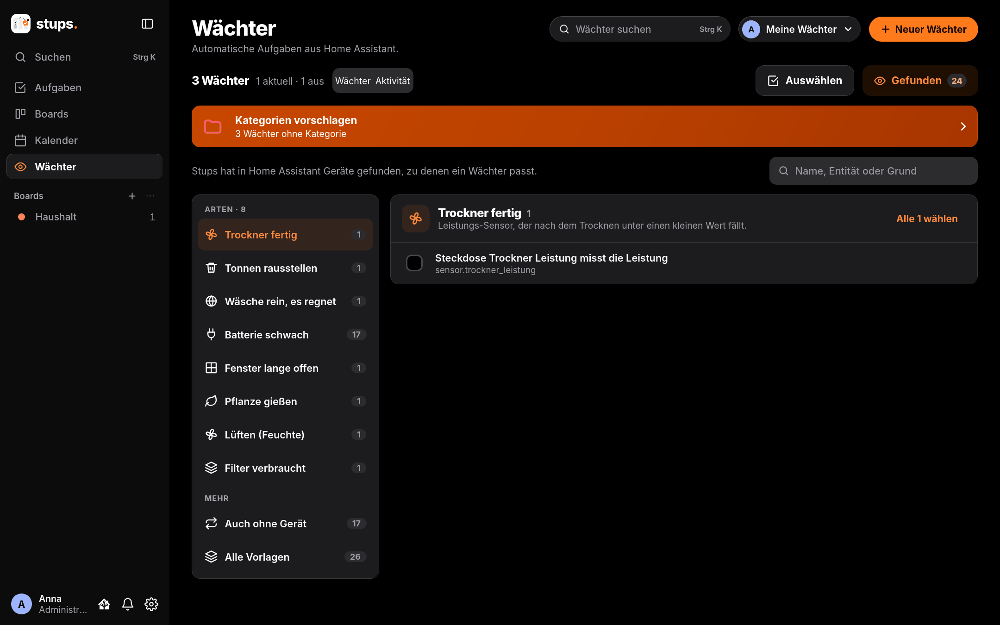
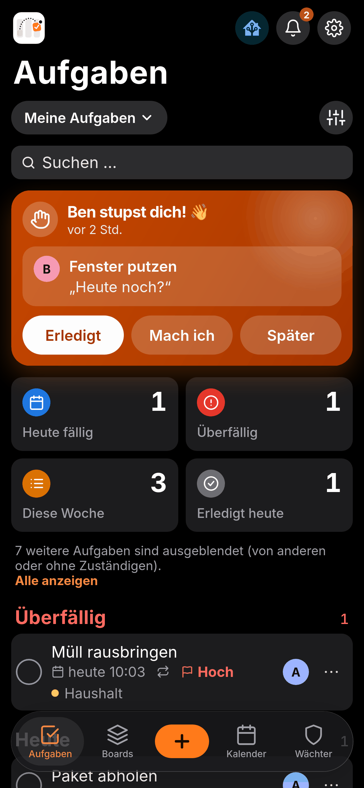
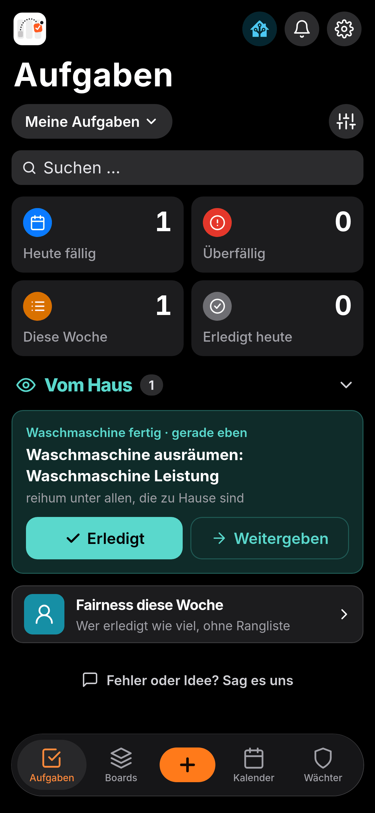
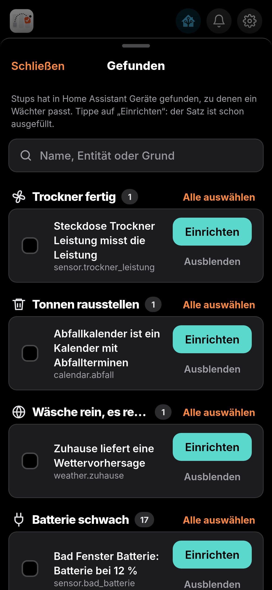
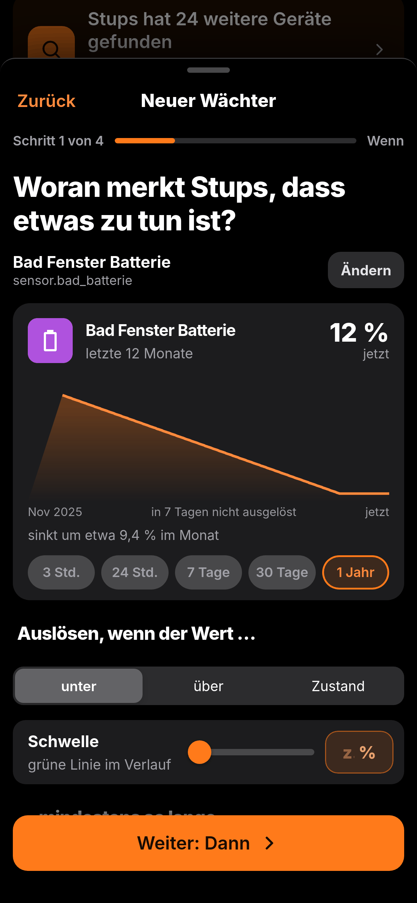
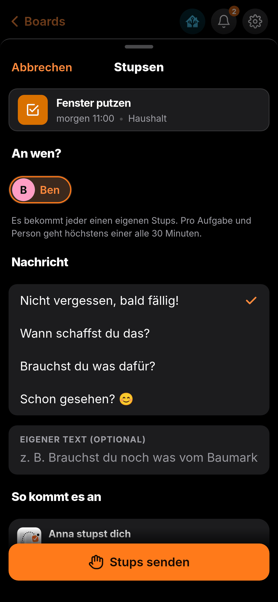

<p align="center"></p>

<div align="center">

🇬🇧 [English version](README.md) · Die englische Fassung ist maßgeblich.

</div>

<h3 align="center">Dein Zuhause merkt, was zu tun ist.<br>Ihr entscheidet, wer es macht.</h3>

<p align="center">
  Stups macht aus dem, was dein Smart Home längst weiß, Aufgaben, gibt sie der richtigen Person und erinnert freundlich.<br>
  Die Waschmaschine ist fertig, wer zu Hause ist bekommt die Aufgabe, mit „Erledigt“-Knopf auf dem Sperrbildschirm.<br>
  <sub>Aufgaben, Boards und Kalender gibt es natürlich auch, direkt in Home Assistant.</sub>
</p>

<p align="center">
  <a href="https://my.home-assistant.io/redirect/supervisor_add_addon_repository/?repository_url=https%3A%2F%2Fgithub.com%2FArrestedOps%2Fha-stups"></a>
  <br><sub>Öffnet in deinem Home Assistant den Dialog mit vorausgefüllter Repository-Adresse. Das Hinzufügen und die Installation bestätigst du dort selbst.</sub>
</p>

---

## Kommt dir das bekannt vor?

- 🧺 *„Wer räumt die Waschmaschine aus?“* Sie ist seit drei Stunden fertig.
- 🗑️ Alle dachten, jemand anderes bringt den Müll raus.
- 😤 Du hast keine Lust mehr, immer die Erinnerungs-Person zu sein.
- 📱 Die To-do-Liste der Familie ist ein Chat, in dem keiner zurückscrollt.
- 🔋 Die Batterie im Türschloss war leer. Aufgefallen ist es zu spät.

**Stups löst den Teil, der wirklich schiefgeht: nicht die Liste, sondern das Erinnern und das Nachfragen.**

## Warum Stups

### 🏠 Es weiß, was dein Haus gerade macht
Home Assistant weiß längst, dass die Waschmaschine fertig ist, morgen die Tonne rausmuss und die Batterie am Türschloss bei 8 % ist. **Wächter** machen daraus von selbst Aufgaben und geben sie reihum und fair an die, die zu Hause sind. Stups **findet passende Geräte selbst** (Waschmaschine, Trockner, Müllkalender, Regen, Batterien, Saugroboter). Einrichten in vier Schritten (oder **mehrere Geräte auf einmal**, zum Beispiel alle Batterien der Fenstersensoren), mit dem Verlauf der Entität bis zu **einem ganzen Jahr** samt Trend („sinkt um etwa 8 % im Monat, erreicht 20 % in etwa 2 Monaten“) und einem **Probelauf über die letzten 7 Tage**, bevor es live geht. Ohne YAML, ohne Automationen, die du pflegen musst.

### 👉 Ein Stups statt Nörgeln
Jemand hat seine Aufgabe vergessen? Schick einen **Stups**: eine freundliche Nachricht, die **zur Aufgabe passt** („Die ist schon überfällig – schaffst du das?“, „Machen wir das zusammen?“), mit den Knöpfen **Erledigt**, **Mach ich** und **Später** direkt in der Nachricht. Sperrzeiten und Ruhezeit pro Person sorgen dafür, dass sich keiner genervt fühlt. Du kannst dich auch **selbst stupsen** („erinnere mich in 2 Stunden nochmal, höchstens 3 ד).

### ✅ Erledigt mit einem Tipp, vom Sperrbildschirm
Push-Erinnerungen über die Home-Assistant-Companion-App: zur Fälligkeit, vorab, nachhakend bei Überfälligkeit und als Morgen-Zusammenfassung. **„Erledigt“ geht direkt in der Nachricht.** Wiederkehrende Aufgaben legen die nächste Aufgabe von selbst an.

### ⚡ Schnell-Eingabe, die mitdenkt
Tippe `Müll raus morgen 19 Uhr @Ben #Haushalt jede Woche !!` und bekomm eine fertige Aufgabe mit Termin, Zuständigem, Kategorie, Wiederholung und Priorität. Deutsch und Englisch, verstanden schon beim Tippen.

### ⚖️ Fair, ohne Rangliste
**Diese Woche** zeigt, wer wie viel getan hat, gewichtet nach Aufwand (klein, mittel, groß). Keine Plätze, keine Medaillen, keine Prozente: Es geht darum, die Last zu *sehen*, nicht um einen Wettbewerb. Rotationen überspringen, wer diese Woche „wenig Zeit“ hat.

### 🔒 Deins. Wirklich.
Alles liegt in deinem Home Assistant (SQLite im Add-on-Speicher, Teil des normalen Backups). Kein Konto, keine Cloud, kein Tracking. **Private Boards** sieht nur du, auch kein Administrator. Es werden keine Schriften oder Skripte aus dem Internet geladen.

### 👨‍👩‍👧 Gebaut für eine ganze Familie
- **Rolle Kind:** Kinder sehen und haken nur ihre eigenen Aufgaben ab. Mit Bestätigung wartet die Aufgabe, bis ein Elternteil „Passt“ oder „Nochmal“ sagt.
- **Haus-Kanäle:** Ein Stups kann auch eine Ansage auf einem Lautsprecher sein oder eine Lampe, die in deiner Farbe leuchtet, für Kinder ohne Handy.
- **Berechtigungen** für einzelne Personen (Wächter, Einstellungen, Personen …), ohne sie zu Administratoren zu machen.

### 📱 Fühlt sich an wie eine echte App
Fürs iPhone gebaut: Dunkel- und Hellmodus, Wischen verschiebt Aufgaben, Live-Sync zwischen allen Geräten, Deutsch und English (auch die Push-Nachrichten). Am Computer ist es eine richtige Desktop-App, kein gestrecktes Handy: eine **Seitenleiste**, Suche (Strg/Cmd + K), Aufgaben als Tabelle, deren Zeilen sich an Ort und Stelle aufklappen, ein Kanban über die volle Breite, ein Kalender mit Zeitraster und ein Formular für Wächter mit Live-Vorschau.

<p align="center">
  <picture><source media="(prefers-color-scheme: light)" srcset="docs/images/desktop-aufgaben-hell.png"></picture>
</p>
<p align="center">
  <picture><source media="(prefers-color-scheme: light)" srcset="docs/images/desktop-waechter-mehrere-hell.png"></picture>
  <picture><source media="(prefers-color-scheme: light)" srcset="docs/images/desktop-gefunden-hell.png"></picture>
</p>
<p align="center">
  <picture><source media="(prefers-color-scheme: light)" srcset="docs/images/aufgaben-hell.png"></picture>
  <picture><source media="(prefers-color-scheme: light)" srcset="docs/images/vom-haus-hell.png"></picture>
  <picture><source media="(prefers-color-scheme: light)" srcset="docs/images/gefunden-hell.png"></picture>
  <picture><source media="(prefers-color-scheme: light)" srcset="docs/images/waechter-diagramm-hell.png"></picture>
  <picture><source media="(prefers-color-scheme: light)" srcset="docs/images/stupsen-hell.png"></picture>
</p>

## Was du bekommst

Das Haus erkennt, Stups verteilt und erinnert, und das Board ist einfach der Ort, an dem alles landet.

| | |
|---|---|
| **Wächter** | Aufgaben aus Entitäten von Home Assistant: vorgeschlagene Geräte („Gefunden“), mehrere Geräte auf einmal, Assistent oder Formular, Ablauf-Editor, Diagramm bis zu einem Jahr mit Trend, Probelauf über 7 Tage, „Weitergeben“, „Erst vorschlagen“ (wer zuerst tippt, übernimmt), Stupsen nach einer Weile, Bescheid, wenn sich eine Aufgabe von selbst erledigt. |
| **Push und Stupsen** | Companion-App-Nachrichten mit Aktionsknöpfen, Tageszusammenfassung, Nachhaken, Stupse mit Vorschlägen, die zur Aufgabe passen, mit Sperr- und Ruhezeit. |
| **Aufgaben (Startseite)** | Was für dich dran ist: Aufgaben vom Haus oben, deine Zahlen (heute fällig, überfällig, diese Woche, heute erledigt), ein Banner, wenn dich jemand gestupst hat, und deine Aufgaben gruppiert nach Überfällig, Heute, Diese Woche, Später und Ohne Termin (immer zuletzt). Ein Menü schaltet zwischen Meine Aufgaben, Alle Aufgaben und jeder Person um. |
| **Boards** | Mehrere Boards mit eigenen Spalten und Kategorien. Aufgaben mit Zuständigen, Termin, Priorität, Kosten, Aufwand, Beschreibung, Checkliste, Links, Fotos/PDFs und Kommentaren. Wischen verschiebt. Archivieren, duplizieren oder als Vorlage speichern (Haushalt, Umzug, Renovierung und mehr). |
| **Private und geteilte Boards** | Sichtbar für „Nur ich“, „Alle in Stups“ oder „Ausgewählte Personen“. Kinder können eigene private Boards anlegen. |
| **Kalender** | Ein eigener Reiter: Tag, 3 Tage, Woche oder Monat (am Computer ein Zeitraster). Auf einen freien Zeitpunkt tippen legt eine Aufgabe dafür an. Filter nach Person und Board. |
| **Wiederkehrende Aufgaben** | Fester Rhythmus oder ab Erledigung, auch stündlich (auf Wunsch nur im Zeitfenster), mit „kleine Verspätung ist okay“. Jede Option zeigt ein Beispiel live. Die erledigte Aufgabe behält ihren Verlauf, die nächste entsteht. |
| **Fairness** | Aufwand pro Person für diese Woche oder diesen Monat, optionale Zusammenfassung am Sonntagabend, Schalter je Board. |
| **Personen und Zugriff** | Jeder bekommt ein Bild (aus Home Assistant oder hochgeladen). Du bestimmst, wer die App öffnen darf. Rollen: Administrator, Mitglied, Kind. |
| **Sensoren für Home Assistant** | Überfällige und heute fällige Aufgaben, gesamt und pro Person, und offene Stupse. Für Dashboards und Automationen. |
| **Feedback** | Fehler melden oder Ideen schicken, direkt in der App; es bleibt auf deiner Installation. |

## In 3 Minuten installiert

Am einfachsten geht es mit dem Knopf oben („Zu Home Assistant hinzufügen“). Von Hand:

1. In Home Assistant: **Einstellungen → Apps → App-Store → ⋮ → Repositories**
2. `https://github.com/ArrestedOps/ha-stups` hinzufügen
3. **Stups** installieren und starten, in der Seitenleiste öffnen. Beim ersten Start führt dich Stups in drei Minuten durch die Einrichtung; Personen wählst du in der App (oder in den Optionen).

Bedienung und Optionen: [stups/DOCS.md](stups/DOCS.md). Änderungen: [stups/CHANGELOG.md](stups/CHANGELOG.md).

### Beta testen

Neue Versionen erscheinen zuerst als **Stups (Beta)**, einer zweiten App mit eigenen Daten, und erst nach dem Test in der normalen App. Wer früh ausprobieren will, fügt in Home Assistant unter **Einstellungen › Apps › App-Store › ⋮ › Repositories** diese Adresse hinzu:

```
https://github.com/ArrestedOps/ha-stups#beta
```

Dort erscheint **Stups (Beta)** (mit „BETA"-Symbol). Sie ist als experimentell markiert, Home Assistant zeigt sie also nur bei eingeschaltetem **erweitertem Modus** (dein Profil, unten links). Aus dieser Adresse erscheint auch ein zweites „Stups": das nicht installieren. In der Beta ist Push zunächst aus, damit niemand Nachrichten doppelt bekommt (die Wächter laufen, schalte sie bei doppelten Aufgaben unter Einstellungen › Beta aus); über **Einstellungen › Hilfe und Daten › Papierkorb, Archiv, Umzug** lassen sich echte Daten einmal hineinkopieren. Alles dazu: [stups-beta/DOCS.md](stups-beta/DOCS.md).

### Ohne Home Assistant (Docker, Beta)

> **Beta.** Der eigene Container ist noch eine Beta: Er funktioniert und wird getestet, bekommt aber vorerst keine neuen Funktionen, bis die App in Home Assistant veröffentlicht ist. **Sicherheit:** Stelle ihn nie ohne HTTPS und einen Reverse-Proxy ins Internet und aktualisiere ihn regelmäßig (Einzelheiten in [docs/docker.md](docs/docker.md)).

Stups läuft auch als eigener Container, zum Beispiel auf einer Synology-NAS, mit eigenen Konten statt Home Assistant:

```yaml
services:
  stups:
    image: ghcr.io/arrestedops/stups:latest
    restart: unless-stopped
    ports: ["8099:8099"]
    environment:
      TZ: Europe/Berlin
    volumes: ["./stups-daten:/data"]
```

Beim ersten Start zeigt das Protokoll (`docker logs stups`) einen Code für die Einrichtung des ersten Administrators. Hinter einer https-Adresse (`STUPS_PUBLIC_URL`) meldest du dich auch mit **Passkey** an (Fingerabdruck oder Gesicht statt Passwort). Aufgaben, Boards, Kalender, Wiederholungen und Stupsen funktionieren wie in der App. Wächter und Sensoren brauchen Home Assistant: Mit `HA_URL` und `HA_TOKEN` (Long-Lived-Token) verbindet sich auch der Container damit. Push-Nachrichten kommen dort über [ntfy](https://ntfy.sh) (`STUPS_NTFY_URL`), mit Knöpfen wie „Erledigt" direkt in der Nachricht. Alles Weitere (Synology, HTTPS, ntfy einrichten, Einstellungen, Umzug): [docs/docker.md](docs/docker.md).

## Dokumentation

| | |
|---|---|
| [stups/DOCS.md](stups/DOCS.md) | Bedienung und Optionen (steht auch in Home Assistant unter „Dokumentation") |
| [docs/docker.md](docs/docker.md) | Stups ohne Home Assistant: Docker, Synology, Anmeldung, Einstellungen |
| [dev/entwicklung.md](dev/entwicklung.md) | Betrieb, Fehlersuche und Entwicklung |
| [dev/testliste.md](dev/testliste.md) | Was am iPhone zu prüfen ist |

## Entwicklung

```bash
pnpm install
pnpm lint && pnpm typecheck && pnpm test && pnpm build
pnpm exec playwright install webkit   # einmalig
pnpm e2e                              # Browser-Tests (WebKit, iPhone-Ansicht)
node e2e/screenshots.mjs              # Screenshots für diese Seite (docs/images; mit --lang en nach docs/images/en)
python3 e2e/shrink-images.py          # danach auf 256 Farben verkleinern (rund ein Drittel der Größe)
node e2e/demo.mjs --lang de           # Demo-GIF (docs/images/demo.de.gif)
```

Details und der Ablauf für neue Versionen stehen in [dev/entwicklung.md](dev/entwicklung.md).

## Lizenz

Stups steht unter der [PolyForm Strict License 1.0.0](LICENSE). Der Quelltext ist einsehbar, aber **nicht frei**:

- **Erlaubt:** Stups für **nicht-kommerzielle Zwecke** nutzen (privat, Haushalt, Familie, WG, Hobby, auch gemeinnützige Organisationen) und den Code lesen. Dass Home Assistant oder Docker das Repository für die Installation und Updates herunterladen, gehört dazu.
- **Nicht erlaubt:** **Weitergeben** (auch Hochladen in ein anderes Repository), **Verändern** und abgeleitete Werke, Unterlizenzieren. **Kommerzielle Nutzung** (zum Beispiel in einer Firma) braucht meine ausdrückliche Genehmigung.
- **GitHub:** Die Nutzungsbedingungen von GitHub erlauben jedem, ein öffentliches Repository innerhalb von GitHub zu forken. Die Lizenz gibt dafür keine weiteren Rechte: Ein Fork darf nicht zum Weitergeben oder Verändern benutzt werden.
- **Frühere Versionen:** Stups 1.9.0 und alle früheren Versionen standen unter der MIT-Lizenz; für diese Versionen, so wie sie damals veröffentlicht wurden, gilt sie weiter.

Die App nutzt die Schrift **Inter** (SIL Open Font License 1.1, lokal aus dem npm-Paket `@fontsource-variable/inter` eingebunden, kein Download von einem Schriftserver).

Der Lizenztext ist der unveränderte englische Standardtext von [PolyForm](https://polyformproject.org/licenses/strict/1.0.0).
