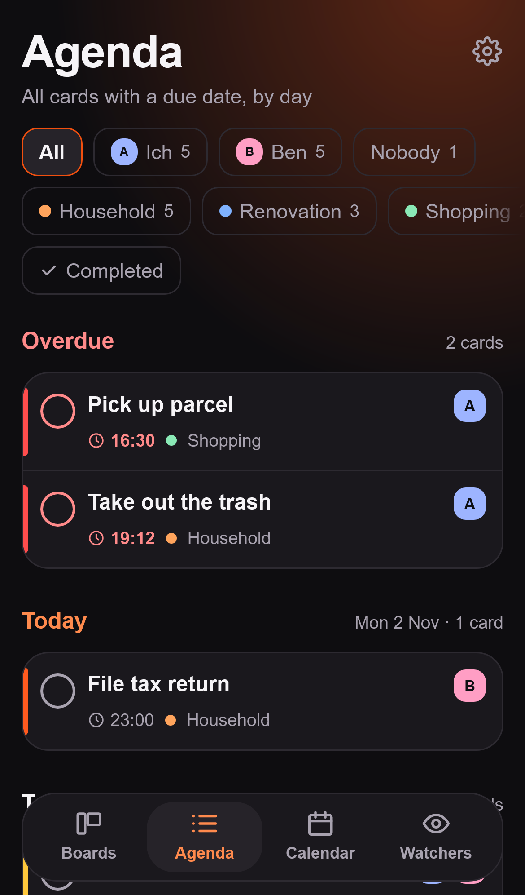
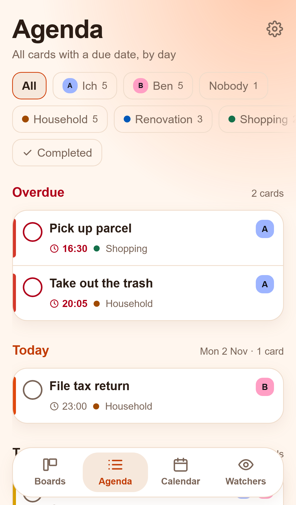
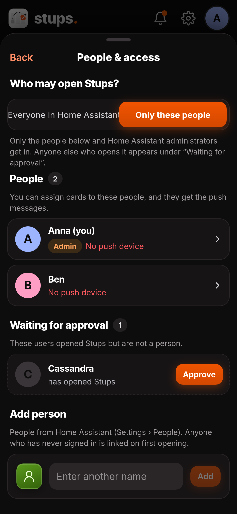

<p align="center"></p>

# Stups

> 🇩🇪 [Deutsche Fassung](README.de.md). This English version is the authoritative one.

A Kanban board, agenda and calendar as a Home Assistant app (add-on). For your household, family or flat share: tasks on boards, recurring due dates, photos and links, push reminders with a "Done" button through the Companion App, and a friendly **nudge** for the person who forgot. Built for the iPhone, with dark and light mode, in English and German.

<p align="center">
  <a href="https://my.home-assistant.io/redirect/supervisor_add_addon_repository/?repository_url=https%3A%2F%2Fgithub.com%2FArrestedOps%2Fha-stups"></a>
  <br><sub>Opens the dialog in your Home Assistant with the repository address filled in. You confirm adding and installing there yourself.</sub>
</p>

<p align="center">
  
</p>

<p align="center">
  
  
  
  
</p>
<p align="center">
  
  
  
  
</p>

<p align="center">
  
  
  
  
</p>

## What can it do?

- **Boards** with their own columns and categories; cards with assignees, due date, priority, cost, description, checklist, links, photos/PDFs and comments. Swiping moves cards, a colour bar shows urgency.
- **Quick entry:** a line like `Take out trash tomorrow 7pm @Ben #Home every week !!` becomes a finished card with due date, assignee, category, repeat and priority.
- **Agenda:** all cards with a due date from all boards, by day, overdue first. Filter by people and boards.
- **Calendar:** day, week and month. Tapping a free slot creates a card with that due date.
- **Recurring tasks:** a fixed rhythm or counted from completion; the completed card stays with its history, the next one is created.
- **Watchers:** Stups observes entities in Home Assistant and creates cards by itself: "The washing machine is done, so whoever is at home gets the card 'empty it'." With a counter (robot vacuum: after 3 cleanings) and "whoever gets home first". Set up without YAML.
- **Push through the Companion App:** when due, in advance, as a follow-up, and a daily summary. "Done" right in the message.
- **Nudging:** send another person a nudge for their card ("Are you on it?"). With lock time and quiet time per person so nobody gets annoyed.
- **Several people:** you control access under Settings › People & Access. Home Assistant administrators set things up; all approved people may create boards, cards and categories.
- **English and German:** the app follows your device language; Settings › Language switches it for you on all your devices, push messages included.
- **Sensors** for Home Assistant: overdue and due-today cards, in total and per person, open nudges.
- Everything stays with you: SQLite in the add-on storage, part of the normal HA backup.

## Installation

The easiest way is the button above ("Add to Home Assistant"). By hand:

1. In Home Assistant: **Settings → Apps → App Store → ⋮ → Repositories**
2. Add `https://github.com/ArrestedOps/ha-stups`
3. Install **Stups**, enter people and notify services in the options, start it.

Usage and options: [stups/DOCS.md](stups/DOCS.md). Changes: [stups/CHANGELOG.md](stups/CHANGELOG.md).

### Trying the beta

New versions appear first as **Stups (Beta)**, a second app with its own data, and only after testing in the normal app. If you want to try things early, add this address in Home Assistant under **Settings › Apps › App Store › ⋮ › Repositories**:

```
https://github.com/ArrestedOps/ha-stups#beta
```

**Stups (Beta)** appears there (with a "BETA" icon). From this address a second "Stups" also appears: do not install that one. In the beta, push and watchers are off at first so nobody gets messages twice; **Settings › Move** copies real data into it once. Everything about it: [stups-beta/DOCS.md](stups-beta/DOCS.md).

### Without Home Assistant (Docker, beta)

> **Beta.** The standalone container is still a beta: it works and is tested, but gets no new features of its own until the app is published in Home Assistant. **Security:** never put it on the internet without HTTPS and a reverse proxy, and update it regularly (details in [docs/docker.md](docs/docker.md)).

Stups also runs as a standalone container, for example on a Synology NAS, with its own accounts instead of Home Assistant:

```yaml
services:
  stups:
    image: ghcr.io/arrestedops/stups:latest
    restart: unless-stopped
    ports: ["8099:8099"]
    environment:
      TZ: Europe/Berlin
    volumes: ["./stups-data:/data"]
```

On first start the log (`docker logs stups`) shows a code for setting up the first administrator. Behind an https address (`STUPS_PUBLIC_URL`) you can also sign in with a **passkey** (fingerprint or face instead of a password). Boards, agenda, calendar, repeats and nudging work as in the app. Watchers and sensors need Home Assistant: with `HA_URL` and `HA_TOKEN` (long-lived token) the container connects to it too. Push messages arrive via [ntfy](https://ntfy.sh) (`STUPS_NTFY_URL`), with buttons such as "Done" right in the message. Everything else (Synology, HTTPS, setting up ntfy, settings, moving): [docs/docker.md](docs/docker.md).

## Documentation

| | |
|---|---|
| [stups/DOCS.md](stups/DOCS.md) | Usage and options (also shown in Home Assistant under "Documentation") |
| [docs/docker.md](docs/docker.md) | Stups without Home Assistant: Docker, Synology, sign-in, settings |
| [docs/entwicklung.md](docs/entwicklung.md) | Operation, troubleshooting and development (German) |
| [docs/testliste.md](docs/testliste.md) | What to check on the iPhone (German) |

Every document with a German counterpart links to it at the top (`*.de.md`).

## Development

```bash
pnpm install
pnpm lint && pnpm typecheck && pnpm test && pnpm build
pnpm exec playwright install webkit   # once
pnpm e2e                              # browser tests (WebKit, iPhone view)
node e2e/screenshots.mjs              # screenshots for this page (docs/images), German
node e2e/screenshots.mjs --lang en    # the same in English (docs/images/en)
```

Details and the procedure for new versions are in [docs/entwicklung.md](docs/entwicklung.md) (German).

## License

Stups is under the [PolyForm Strict License 1.0.0](LICENSE). The source code is viewable, but **not free**:

- **Allowed:** using Stups for **non-commercial purposes** (private, household, family, flat share, hobby, also non-profit organisations) and reading the code. That Home Assistant or Docker download the repository for installation and updates is part of this.
- **Not allowed:** **distributing** it (including uploading it to another repository), **modifying** it and making derivative works, sublicensing. **Commercial use** (for example in a company) needs my explicit permission.
- **GitHub:** GitHub's terms of service let anyone fork a public repository within GitHub. The license grants no further rights for that: a fork must not be used to distribute or modify.
- **Earlier versions:** Stups 1.9.0 and all earlier versions were under the MIT license; for those versions, as they were published at the time, it continues to apply.

The license text is the unmodified English standard text from [PolyForm](https://polyformproject.org/licenses/strict/1.0.0).
