<p align="center"></p>

# Stups

Kanban-Board, Agenda und Kalender als Home-Assistant-App (Add-on). Für den Haushalt, die Familie oder die WG: Aufgaben auf Boards, wiederkehrende Termine, Fotos und Links, Push-Erinnerungen mit „Erledigt"-Knopf über die Companion App und ein freundlicher **Stups** an die, die etwas vergessen haben. Fürs iPhone gebaut, mit Dunkel- und Hellmodus.

<p align="center">
  <a href="https://my.home-assistant.io/redirect/supervisor_add_addon_repository/?repository_url=https%3A%2F%2Fgithub.com%2FArrestedOps%2Fha-stups"></a>
  <br><sub>Öffnet in deinem Home Assistant den Dialog mit vorausgefüllter Repository-Adresse. Das Hinzufügen und die Installation bestätigst du dort selbst.</sub>
</p>

<p align="center">
  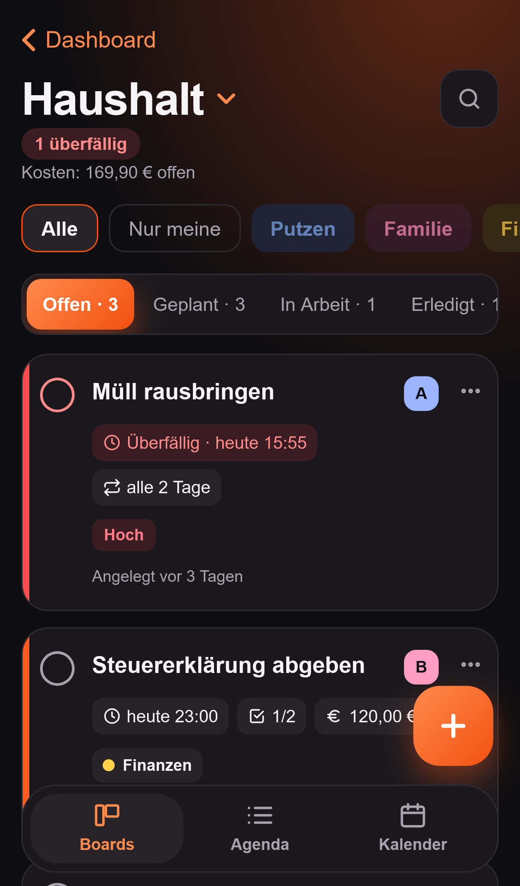
  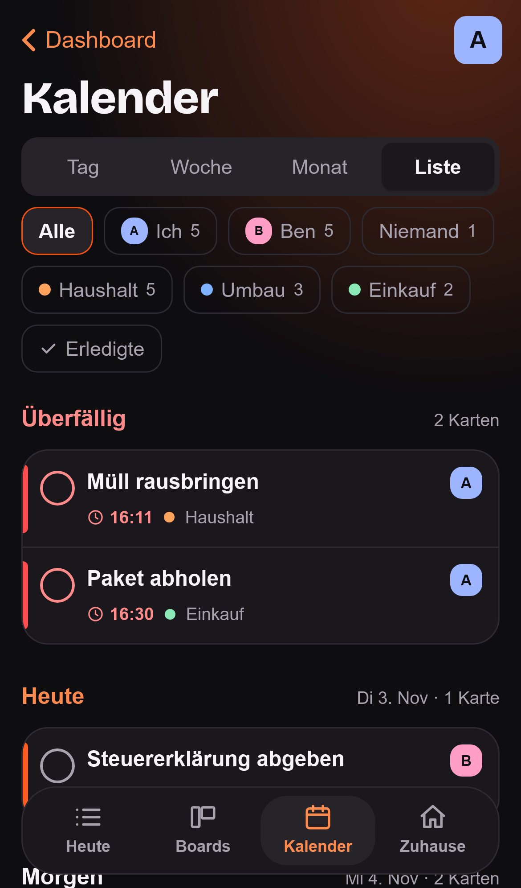
  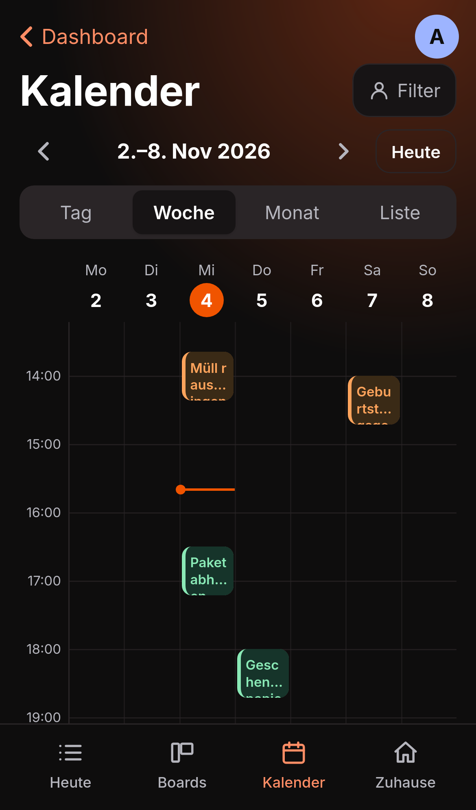
  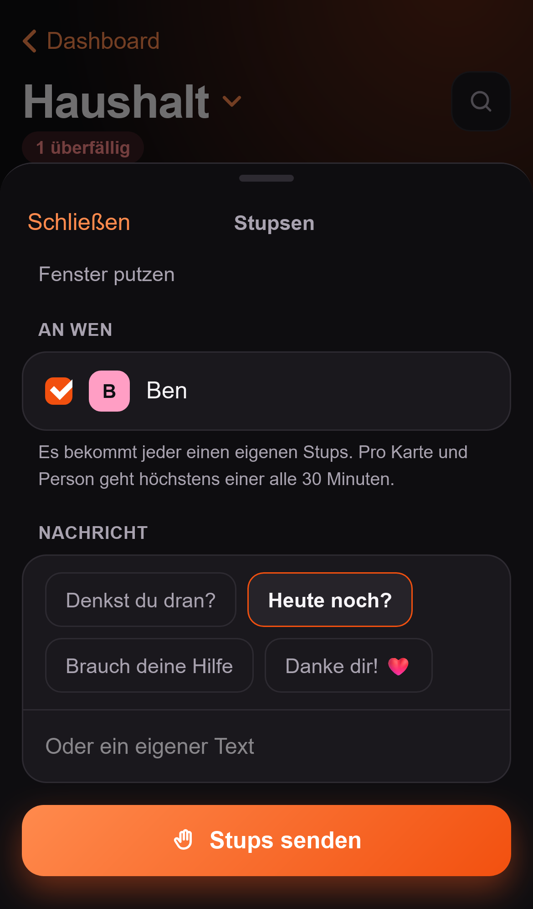
</p>
<p align="center">
  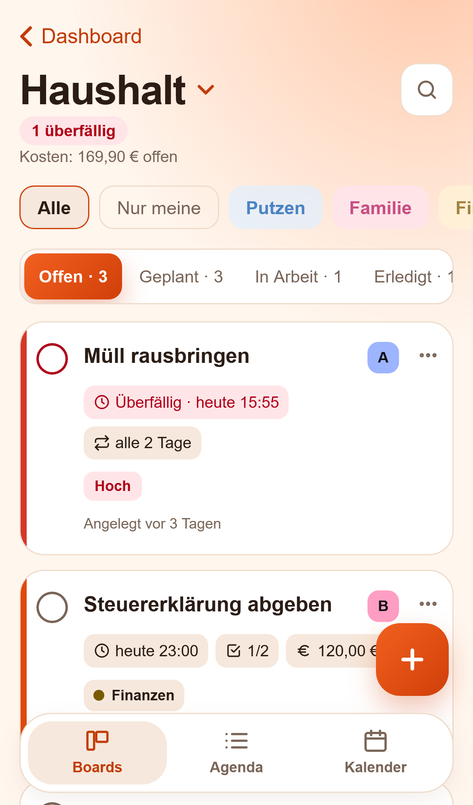
  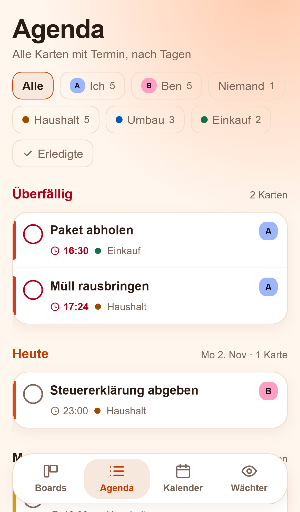
  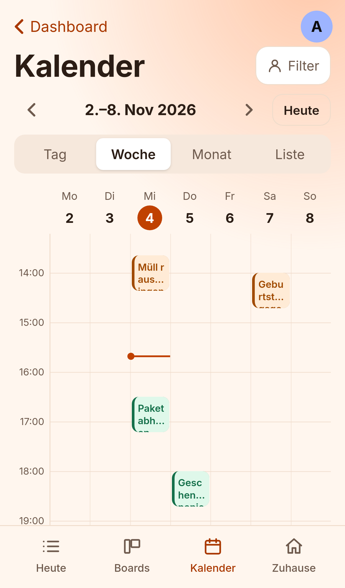
  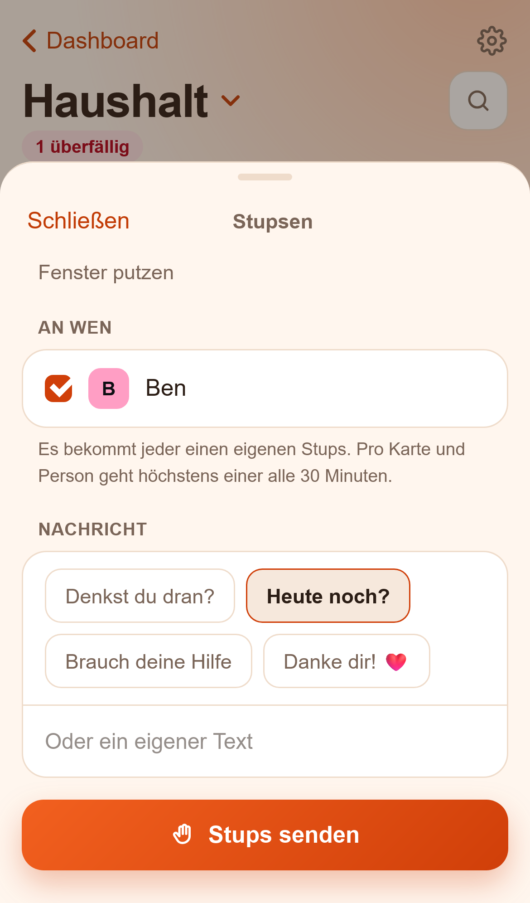
</p>

<p align="center">
  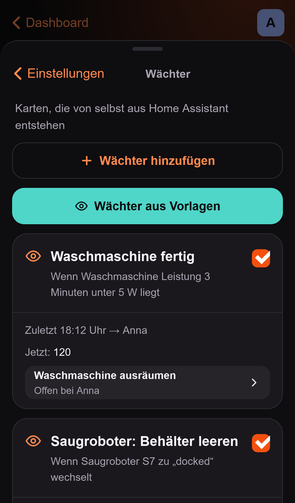
  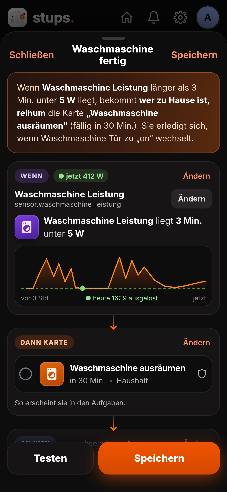
  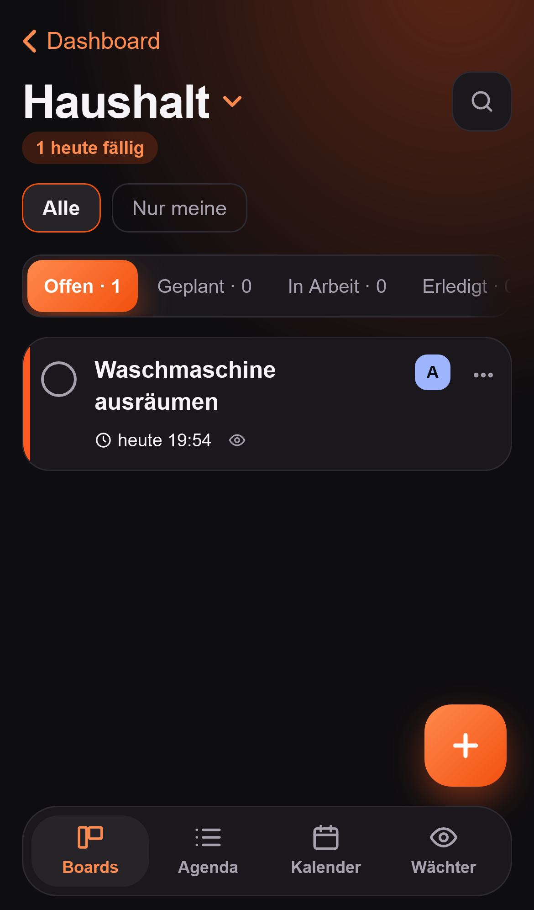
  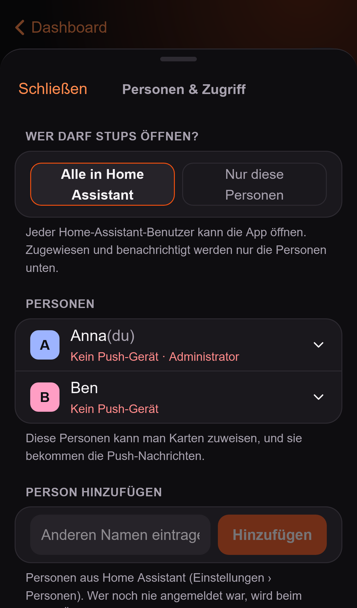
</p>

## Was kann es?

- **Boards** mit eigenen Spalten und Kategorien, Karten mit Zuständigen, Termin, Priorität, Kosten, Beschreibung, Checkliste, Links, Fotos/PDFs und Kommentaren. Wischen verschiebt Karten, ein Farbbalken zeigt die Dringlichkeit.
- **Agenda:** alle Karten mit Termin aus allen Boards, nach Tagen, Überfälliges zuerst. Filter nach Personen und Boards.
- **Kalender:** Tag, Woche und Monat. Auf einen freien Zeitpunkt tippen legt eine Karte mit diesem Termin an.
- **Wiederkehrende Aufgaben:** fester Rhythmus oder ab Erledigung; die erledigte Karte bleibt samt Verlauf erhalten, die nächste entsteht neu.
- **Wächter:** Stups beobachtet Entitäten in Home Assistant und legt von selbst Karten an: „Die Waschmaschine ist fertig, also bekommt eine Person, die zu Hause ist, die Karte ‚ausräumen'." Mit Zähler (Saugroboter: nach 3 Reinigungen) und „wer zuerst nach Hause kommt". Einrichtung ohne YAML.
- **Push über die Companion App:** zur Fälligkeit, vorab, nachhaken, Tageszusammenfassung. „Erledigt" direkt in der Nachricht.
- **Stupsen:** einer anderen Person zu ihrer Karte einen Stups schicken („Denkst du dran?"). Mit Sperrzeit und Ruhezeit pro Person, damit niemand genervt wird.
- **Mehrere Personen:** Zugriff steuerst du unter Einstellungen › Personen & Zugriff. Wer Administrator in Home Assistant ist, stellt ein; alle freigegebenen Personen dürfen Boards, Karten und Kategorien anlegen.
- **Sensoren** für Home Assistant: überfällige und heute fällige Karten, gesamt und je Person, offene Stupse.
- Alles bleibt bei dir: SQLite im Add-on-Speicher, Teil des normalen HA-Backups.

## Installation

Am einfachsten über den Knopf oben („Zu Home Assistant hinzufügen"). Von Hand:

1. In Home Assistant: **Einstellungen → Apps → App-Store → ⋮ → Repositories**
2. `https://github.com/ArrestedOps/ha-stups` hinzufügen
3. **Stups** installieren, Personen und Notify-Dienste in den Optionen eintragen, starten.

Bedienung und Optionen: [stups/DOCS.md](stups/DOCS.md). Änderungen: [stups/CHANGELOG.md](stups/CHANGELOG.md).

### Beta testen

Neue Versionen erscheinen zuerst als **Stups (Beta)**, einer zweiten App mit eigenen Daten, und erst nach dem Test in der normalen App. Wer früh ausprobieren will, fügt in Home Assistant unter **Einstellungen › Apps › App-Store › ⋮ › Repositories** diese Adresse hinzu:

```
https://github.com/ArrestedOps/ha-stups#beta
```

Dort erscheint **Stups (Beta)** (mit „BETA"-Symbol). Aus dieser Adresse erscheint auch ein zweites „Stups": das nicht installieren. In der Beta sind Push und Wächter zunächst aus, damit niemand Nachrichten doppelt bekommt; über **Einstellungen › Umzug** lassen sich echte Daten einmal hineinkopieren. Alles dazu: [stups-beta/DOCS.md](stups-beta/DOCS.md).

### Ohne Home Assistant (Docker, Beta)

> **Beta.** Der eigene Container ist noch eine Beta: Er funktioniert und wird getestet, bekommt aber vorerst keine neuen Funktionen, bis die App in Home Assistant veröffentlicht ist. **Sicherheit:** Stelle ihn nie ohne HTTPS und einen Reverse-Proxy ins Internet und aktualisiere ihn regelmäßig (Einzelheiten in [docs/docker.md](docs/docker.md)).

Stups läuft auch als eigener Container, zum Beispiel auf einer Synology-NAS, mit eigenen Konten statt Home Assistant:

```yaml
services:
  stups:
    image: ghcr.io/arrestedops/stups:latest
    restart: unless-stopped
    ports: ["8099:8099"]
    environment:
      TZ: Europe/Berlin
    volumes: ["./stups-daten:/data"]
```

Beim ersten Start zeigt das Protokoll (`docker logs stups`) einen Code für die Einrichtung des ersten Administrators. Hinter einer https-Adresse (`STUPS_PUBLIC_URL`) meldest du dich auch mit **Passkey** an (Fingerabdruck oder Gesicht statt Passwort). Boards, Agenda, Kalender, Wiederholungen und Stupsen funktionieren wie in der App. Wächter und Sensoren brauchen Home Assistant: Mit `HA_URL` und `HA_TOKEN` (Long-Lived-Token) verbindet sich auch der Container damit. Push-Nachrichten kommen dort über [ntfy](https://ntfy.sh) (`STUPS_NTFY_URL`), mit Knöpfen wie „Erledigt" direkt in der Nachricht. Alles Weitere (Synology, HTTPS, ntfy einrichten, Einstellungen, Umzug): [docs/docker.md](docs/docker.md).

## Dokumentation

| | |
|---|---|
| [stups/DOCS.md](stups/DOCS.md) | Bedienung und Optionen (steht auch in Home Assistant unter „Dokumentation") |
| [docs/docker.md](docs/docker.md) | Stups ohne Home Assistant: Docker, Synology, Anmeldung, Einstellungen |
| [docs/entwicklung.md](docs/entwicklung.md) | Betrieb, Fehlersuche und Entwicklung |
| [docs/testliste.md](docs/testliste.md) | Was am iPhone zu prüfen ist |

## Entwicklung

```bash
pnpm install
pnpm lint && pnpm typecheck && pnpm test && pnpm build
pnpm exec playwright install webkit   # einmalig
pnpm e2e                              # Browser-Tests (WebKit, iPhone-Ansicht)
node e2e/screenshots.mjs              # Screenshots für diese Seite (docs/images)
```

Details und der Ablauf für neue Versionen stehen in [docs/entwicklung.md](docs/entwicklung.md).

## Lizenz

Der Quelltext ist einsehbar, aber **nicht frei**: Du darfst Stups installieren, für dich selbst nutzen und den Code lesen. **Kopieren, Verändern, Weitergeben und Hochladen** (auch als Kopie in ein anderes Repository) ist nicht erlaubt. Dass Home Assistant oder Docker das Repository für die Installation herunterladen, ist ausdrücklich erlaubt. Einzelheiten: [LICENSE](LICENSE).

Stups 1.9.0 und alle früheren Versionen standen unter der MIT-Lizenz; für diese Versionen, so wie sie damals veröffentlicht wurden, gilt sie weiter.
