<p align="center"></p>

<h3 align="center">The household runs itself. Nobody has to nag.</h3>

<p align="center">
  Tasks, calendar and a friendly nudge, built right into Home Assistant.<br>
  The washing machine finishes and the right person gets the card, with a <b>Done</b> button on their lock screen.
</p>

<p align="center">
  <a href="https://my.home-assistant.io/redirect/supervisor_add_addon_repository/?repository_url=https%3A%2F%2Fgithub.com%2FArrestedOps%2Fha-stups"></a>
  <br><sub>Opens the dialog in your Home Assistant with the repository address filled in. You confirm adding and installing there yourself.</sub>
</p>

<p align="center"><sub>🇩🇪 <a href="README.de.md">Deutsche Fassung</a> · This English version is the authoritative one.</sub></p>

<p align="center">
  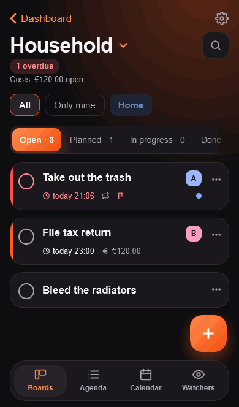
</p>

---

## Sound familiar?

- 🧺 *"Who is emptying the washing machine?"* The machine has been done for three hours.
- 🗑️ Everyone assumed someone else would take out the trash.
- 😤 You hate being the one who reminds everybody. Again.
- 📱 Your family's to-do list is a chat that nobody scrolls back through.
- 🔋 The battery in the door lock died. Nobody noticed until it was too late.

**Stups fixes the part that actually goes wrong: not the list, but the remembering and the asking.**

## Why Stups

### 🏠 It knows what your house is doing
Home Assistant already knows that the washing machine is done, the bin is going out tomorrow and the lock battery is at 8 %. **Watchers** turn that into cards by themselves, and hand them to whoever is at home, in turns, fairly. Stups **finds the matching devices itself** (washing machine, dryer, waste calendar, rain, batteries, robot vacuum). You set one up in four taps, see the entity's last three hours, and do a **trial run on the last 7 days** before it goes live. No YAML, no automations to maintain.

### 👉 A nudge instead of a nag
Someone forgot their task? Send a **Stups**: a friendly "Are you on it?" with **Done**, **On it** and **Later** buttons right in the notification. Lock times and quiet hours per person mean nobody gets annoyed. You can also **nudge yourself** ("remind me again in 2 hours, at most 3 times").

### ✅ Done in one tap, from the lock screen
Push reminders through the Home Assistant Companion App: when due, in advance, as a follow-up while overdue and as a morning summary. **"Done" works right in the message.** Repeating tasks create the next card by themselves.

### ⚡ Quick entry that reads your mind
Type `Take out trash tomorrow 7pm @Ben #Home every week !!` and get a finished card with due date, assignee, category, repeat and priority. German and English, understood as you write.

### ⚖️ Fair, without a scoreboard
**This week** shows who did how much, weighted by effort (small, medium, large). No ranking, no medals, no percentages: the point is to *see the load*, not to compete. Rotations skip anyone who has "little time" this week.

### 🔒 Yours. Really.
Everything lives in your Home Assistant (SQLite in the add-on storage, part of the normal backup). No account, no cloud, no tracking. **Private boards** are visible only to you, not even to administrators. No fonts or scripts are loaded from the internet.

### 👨‍👩‍👧 Made for a whole family
- **Child role:** children see and tick off only their own cards. With confirmation, the card waits until a parent says "Confirm" or "Again".
- **House channels:** a nudge can also be an announcement on a speaker or a lamp that lights up in your colour, for children without a phone.
- **Permissions** for individuals (watchers, settings, people …) without making them administrators.

### 📱 Feels like a native app
Built for the iPhone: dark and light mode, swipe to move cards, live sync between all devices, English and German (push messages included). On a desktop you get a **sidebar layout** with search (Ctrl/Cmd + K), a Kanban over the full width and a detail column.

<p align="center">
  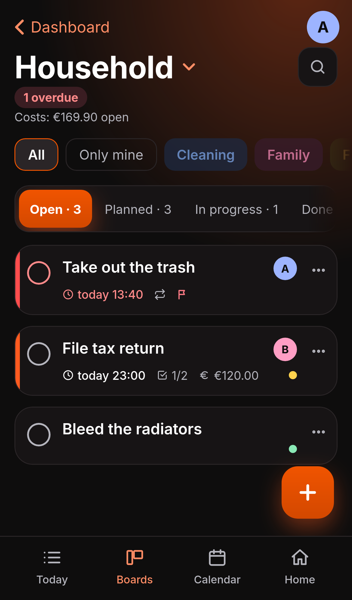
  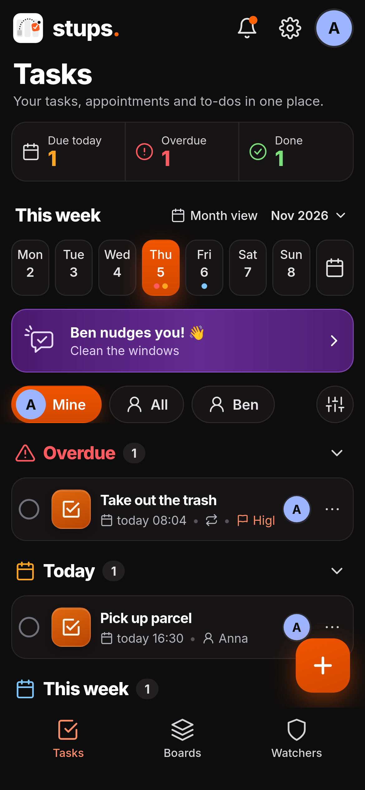
  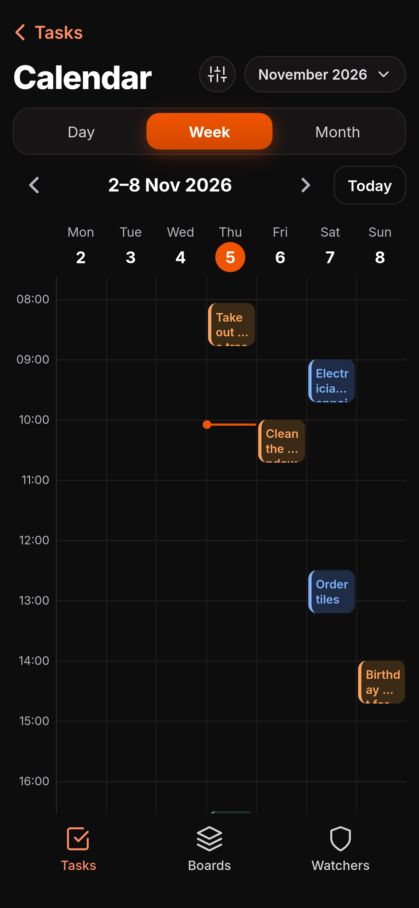
  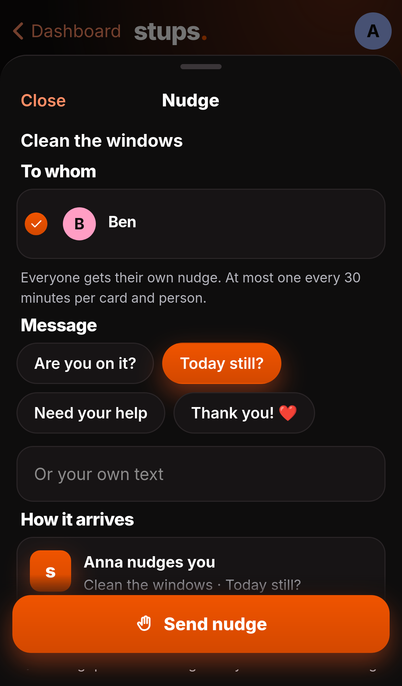
</p>
<p align="center">
  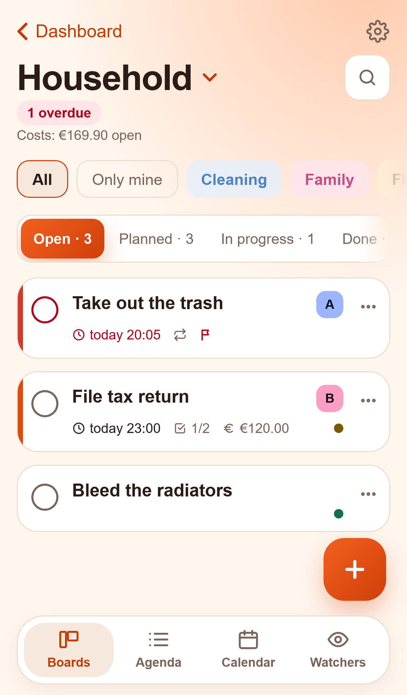
  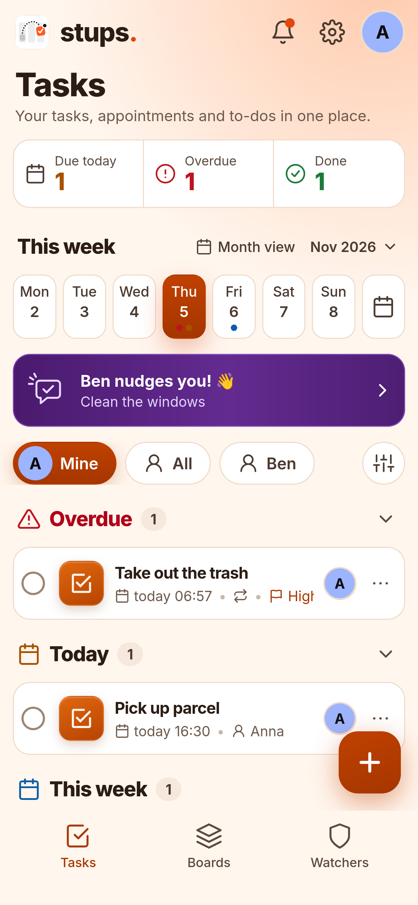
  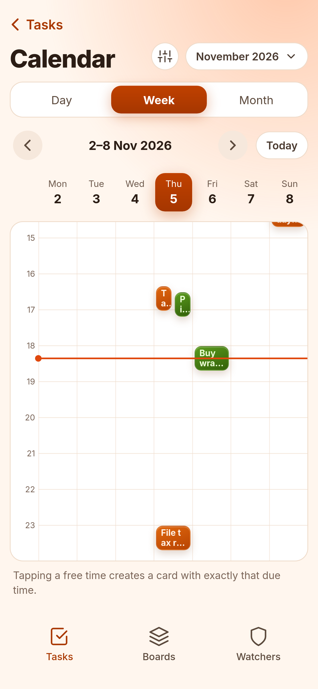
  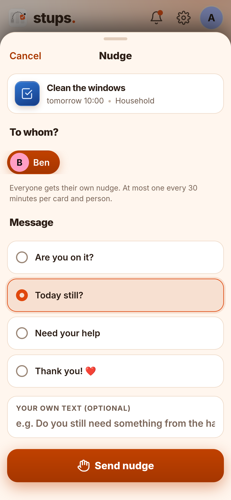
</p>
<p align="center">
  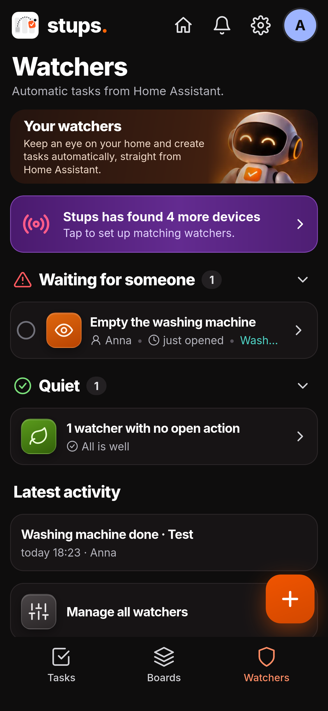
  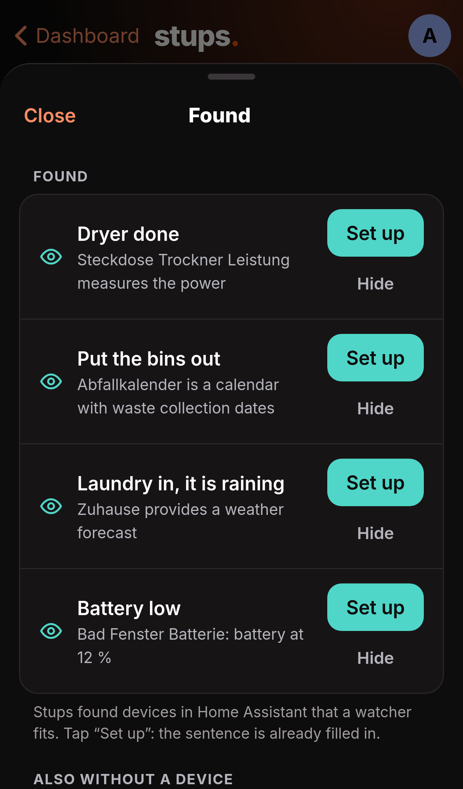
  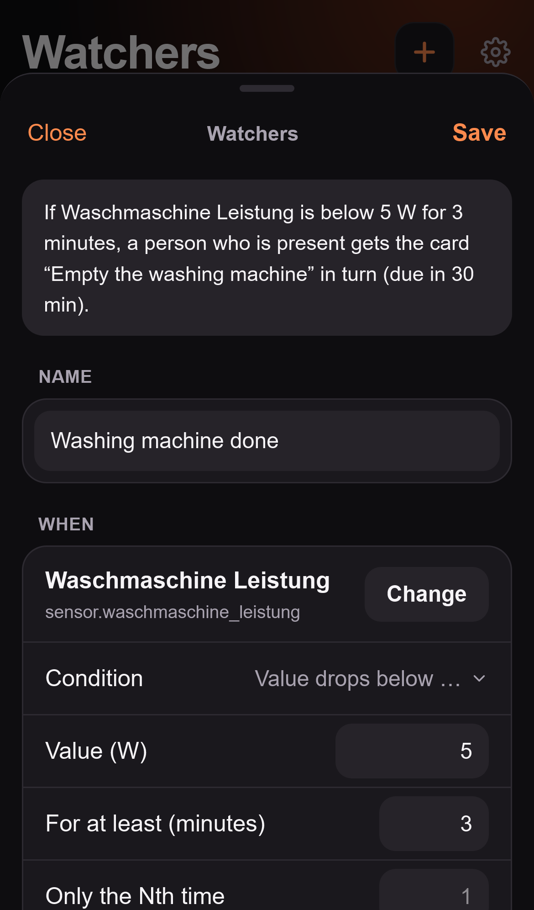
  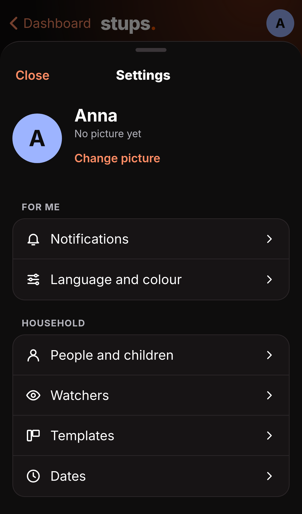
</p>

## What you get

| | |
|---|---|
| **Tasks (start page)** | What is on for you: cards from the house on top, your numbers (due today, overdue, done today), the week, a banner when someone nudged you, and your cards grouped as Overdue, Today, This week, Later. Chips switch between Mine, All and each person. |
| **Boards** | Several boards with their own columns and categories. Cards with assignees, due date, priority, cost, effort, description, checklist, links, photos/PDFs and comments. Swipe to move. Archive, duplicate, or save as a template (Household, Moving house, Renovation and more). |
| **Private & shared boards** | Visible to "Only me", "Everyone in Stups" or "Selected people". Children can create their own private boards. |
| **Calendar** | Day, week, month or list. Tap a free slot to create a card for that time. Filter by person and board. |
| **Recurring tasks** | Fixed rhythm or counted from completion, also hourly (optionally within a time window), with "a small delay is okay". Every option shows a live example. The finished card keeps its history; the next one is created. |
| **Watchers** | Cards from Home Assistant entities: suggested devices, four-step assistant, flow editor, trial run on the last 7 days, "pass on", "suggest first" (whoever taps first takes it), nudging after a while. |
| **Push and nudging** | Companion App notifications with action buttons, daily summary, follow-ups, nudges with lock and quiet time. |
| **Fairness** | Effort per person for this week or month, optional Sunday-evening summary, per-board switch. |
| **People and access** | Everyone gets a picture (from Home Assistant or uploaded). Control who may open the app. Roles: administrator, member, child. |
| **Sensors for Home Assistant** | Overdue and due-today cards, in total and per person, and open nudges. Use them on dashboards and in automations. |
| **Feedback** | Report bugs or ideas from inside the app; it stays on your installation. |

## Install in 3 minutes

The easiest way is the button at the top ("Add to Home Assistant"). By hand:

1. In Home Assistant: **Settings → Apps → App Store → ⋮ → Repositories**
2. Add `https://github.com/ArrestedOps/ha-stups`
3. Install and start **Stups**, open it from the sidebar. You pick the people in the app (or in the options); done.

Usage and options: [stups/DOCS.md](stups/DOCS.md). Changes: [stups/CHANGELOG.md](stups/CHANGELOG.md).

### Trying the beta

New versions appear first as **Stups (Beta)**, a second app with its own data, and only after testing in the normal app. If you want to try things early, add this address in Home Assistant under **Settings › Apps › App Store › ⋮ › Repositories**:

```
https://github.com/ArrestedOps/ha-stups#beta
```

**Stups (Beta)** appears there (with a "BETA" icon). From this address a second "Stups" also appears: do not install that one. In the beta, push and watchers are off at first so nobody gets messages twice; **Settings › Help and data › Bin, archive, move** copies real data into it once. Everything about it: [stups-beta/DOCS.md](stups-beta/DOCS.md).

### Without Home Assistant (Docker, beta)

> **Beta.** The standalone container is still a beta: it works and is tested, but gets no new features of its own until the app is published in Home Assistant. **Security:** never put it on the internet without HTTPS and a reverse proxy, and update it regularly (details in [docs/docker.md](docs/docker.md)).

Stups also runs as a standalone container, for example on a Synology NAS, with its own accounts instead of Home Assistant:

```yaml
services:
  stups:
    image: ghcr.io/arrestedops/stups:latest
    restart: unless-stopped
    ports: ["8099:8099"]
    environment:
      TZ: Europe/Berlin
    volumes: ["./stups-data:/data"]
```

On first start the log (`docker logs stups`) shows a code for setting up the first administrator. Behind an https address (`STUPS_PUBLIC_URL`) you can also sign in with a **passkey** (fingerprint or face instead of a password). Boards, agenda, calendar, repeats and nudging work as in the app. Watchers and sensors need Home Assistant: with `HA_URL` and `HA_TOKEN` (long-lived token) the container connects to it too. Push messages arrive via [ntfy](https://ntfy.sh) (`STUPS_NTFY_URL`), with buttons such as "Done" right in the message. Everything else (Synology, HTTPS, setting up ntfy, settings, moving): [docs/docker.md](docs/docker.md).

## Documentation

| | |
|---|---|
| [stups/DOCS.md](stups/DOCS.md) | Usage and options (also shown in Home Assistant under "Documentation") |
| [docs/docker.md](docs/docker.md) | Stups without Home Assistant: Docker, Synology, sign-in, settings |
| [docs/entwicklung.md](docs/entwicklung.md) | Operation, troubleshooting and development (German) |
| [docs/testliste.md](docs/testliste.md) | What to check on the iPhone (German) |

Every document with a German counterpart links to it at the top (`*.de.md`).

## Development

```bash
pnpm install
pnpm lint && pnpm typecheck && pnpm test && pnpm build
pnpm exec playwright install webkit   # once
pnpm e2e                              # browser tests (WebKit, iPhone view)
node e2e/screenshots.mjs              # screenshots for this page (docs/images), German
node e2e/screenshots.mjs --lang en    # the same in English (docs/images/en)
```

Details and the procedure for new versions are in [docs/entwicklung.md](docs/entwicklung.md) (German).

## License

Stups is under the [PolyForm Strict License 1.0.0](LICENSE). The source code is viewable, but **not free**:

- **Allowed:** using Stups for **non-commercial purposes** (private, household, family, flat share, hobby, also non-profit organisations) and reading the code. That Home Assistant or Docker download the repository for installation and updates is part of this.
- **Not allowed:** **distributing** it (including uploading it to another repository), **modifying** it and making derivative works, sublicensing. **Commercial use** (for example in a company) needs my explicit permission.
- **GitHub:** GitHub's terms of service let anyone fork a public repository within GitHub. The license grants no further rights for that: a fork must not be used to distribute or modify.
- **Earlier versions:** Stups 1.9.0 and all earlier versions were under the MIT license; for those versions, as they were published at the time, it continues to apply.

The app uses the font **Inter** (SIL Open Font License 1.1, bundled locally from the npm package `@fontsource-variable/inter`, no download from a font server).

The license text is the unmodified English standard text from [PolyForm](https://polyformproject.org/licenses/strict/1.0.0).
