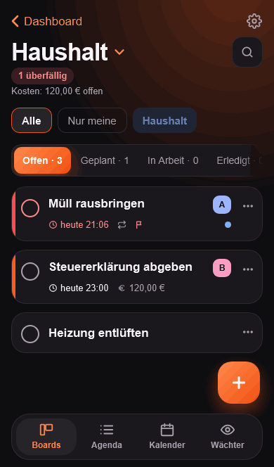

<!-- ENTWURF, NICHT VERÖFFENTLICHT. Für deutsche Foren (zum Beispiel das deutschsprachige Home-Assistant-Forum). Vor dem Posten Version und Links prüfen, Bilder hochladen. -->

# Stups: Kanban, Agenda und Kalender für den Haushalt als Home-Assistant-App

Hallo zusammen,

ich habe **Stups** gebaut, ein Kanban-Board für den Haushalt direkt in Home Assistant (Ingress, kein eigener Login). Wir nutzen es zu Hause für alles, was „jemand mal machen müsste", und ich habe es jetzt so weit aufgeräumt, dass ich es teilen mag.

## Was es kann

- **Boards, Agenda, Kalender.** Mehrere Boards mit eigenen Spalten und Kategorien; die Agenda zeigt alle Karten mit Termin aus allen Boards nach Tagen, der Kalender Tag, Woche und Monat.
- **Schnell-Eingabe:** `Müll raus morgen 19 Uhr @Ben #Haushalt jede Woche !!` wird zu einer fertigen Karte mit Termin, Zuständigem, Kategorie, Wiederholung und Priorität. Erkanntes zeigt Stups als Chips, die man wegtippen kann.
- **Wiederkehrende Aufgaben** mit festem Rhythmus oder ab Erledigung; die erledigte Karte behält ihren Verlauf.
- **Push über die Companion App** mit „Erledigt"-Knopf direkt in der Nachricht: zur Fälligkeit, vorab, nachhakend und als Tageszusammenfassung.
- **Stupsen:** Ein freundliches „Denkst du dran?" an die Person, die etwas vergessen hat, mit Sperrzeit und Ruhezeit je Person.
- **Wächter:** Stups beobachtet Entitäten und legt Karten von selbst an: *Waschmaschine fertig → wer zu Hause ist, bekommt „ausräumen".* Mit Zähler (Saugroboter nach 3 Reinigungen) und „wer zuerst nach Hause kommt", ohne YAML. Für eigene Automationen gibt es das Ereignis `stups_create_card`.
- **Sensoren** für überfällige und heute fällige Karten, gesamt und je Person.
- Fürs **iPhone** gebaut (dunkel und hell), auf Deutsch und Englisch. Die Daten bleiben im Add-on-Speicher und sind Teil des normalen HA-Backups.

## Installation

oder `https://github.com/ArrestedOps/ha-stups` unter Einstellungen → Apps → App-Store → ⋮ → Repositories eintragen. Neue Versionen erscheinen zuerst in einer eigenen App **Stups (Beta)** mit eigenen Daten (`https://github.com/ArrestedOps/ha-stups#beta`).

Es gibt auch ein eigenständiges Docker-Image (eigene Konten, Passkeys, Push über ntfy); das ist aber eine Beta und bekommt vorerst keine eigenen neuen Funktionen.

## Zur Lizenz (bitte lesen)

Der Quelltext ist **einsehbar, aber nicht Open Source**: Stups steht unter der [PolyForm Strict License 1.0.0](https://github.com/ArrestedOps/ha-stups/blob/main/LICENSE). Nicht-kommerzielle Nutzung (privat, Familie, WG, Hobby, gemeinnützige Organisationen) ist in Ordnung; Weitergeben, Verändern und kommerzielle Nutzung nur mit meiner Genehmigung. Dass Home Assistant das Repository zum Installieren und Aktualisieren herunterlädt, gehört selbstverständlich zur Nutzung.

## Rückmeldung

Mich interessiert, was fehlt oder unklar ist, besonders von Leuten, die es nicht mit einem iPhone nutzen. Fragen und Fehler: https://github.com/ArrestedOps/ha-stups/issues

Danke fürs Lesen!
