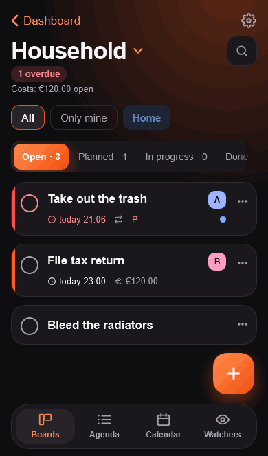

<!-- ENTWURF, NICHT VERÖFFENTLICHT. Für das Home-Assistant-Community-Forum (Bereich „Share your Projects“). Vor dem Posten: Version und Links prüfen, Bilder hochladen. -->

# Stups – a Kanban board, agenda and calendar for the household, as a Home Assistant app

**Title suggestion:** Stups: shared household tasks with push reminders, nudges and watchers (HA app, iPhone-first)

Hi everyone,

I built **Stups**, a Kanban board for the household that lives inside Home Assistant (Ingress, no separate login). We use it at home for chores, repairs and everything that "someone should do" – and I finally cleaned it up enough to share.

## What it does

- **Boards, agenda and calendar.** Several boards with their own columns and categories. The agenda lists all cards with a due date from all boards, by day; the calendar has day, week and month.
- **Quick entry.** Type `Take out trash tomorrow 7pm @Ben #Home every week !!` and you get a finished card with due date, assignee, category, repeat and priority. What was understood is shown as chips you can tap away.
- **Recurring tasks** – either a fixed rhythm or counted from completion. The completed card keeps its history, the next one is created.
- **Push through the Companion App** with a "Done" button right in the notification: when due, in advance, as a follow-up, plus a daily summary.
- **Nudging.** Send someone a friendly "Are you on it?" for their card. Lock time and quiet time per person, so nobody gets nagged.
- **Watchers.** Stups observes entities in Home Assistant and creates cards by itself: *"The washing machine is done → whoever is at home gets 'empty it'."* With a counter (robot vacuum: after 3 cleanings) and "whoever gets home first". No YAML needed. There is also an event (`stups_create_card`) for your own automations.
- **Sensors** for overdue / due-today cards, in total and per person.
- Built for the **iPhone** (dark and light mode), English and German, data stays in the add-on storage (part of the normal HA backup).

## Install

or add `https://github.com/ArrestedOps/ha-stups` under Settings → Apps → App Store → ⋮ → Repositories. New versions appear first in a separate **Stups (Beta)** app with its own data (`https://github.com/ArrestedOps/ha-stups#beta`).

There is also a standalone Docker image (own accounts, passkeys, push via ntfy), but that one is a beta and gets no new features of its own for now.

## About the license (please read)

The source is **viewable, but not open source**: Stups is under the [PolyForm Strict License 1.0.0](https://github.com/ArrestedOps/ha-stups/blob/main/LICENSE). Non-commercial use (home, family, flat share, hobby, non-profits) is fine; redistribution, modification and commercial use are not without my permission. Home Assistant downloading the repository to install and update is of course part of "use". I know this is a trade-off in a community that likes open source – I'd rather be upfront about it.

## Feedback

I'd love to hear what is missing or confusing, especially from people who run it on something other than an iPhone. Issues and questions: https://github.com/ArrestedOps/ha-stups/issues

Thanks for reading!
