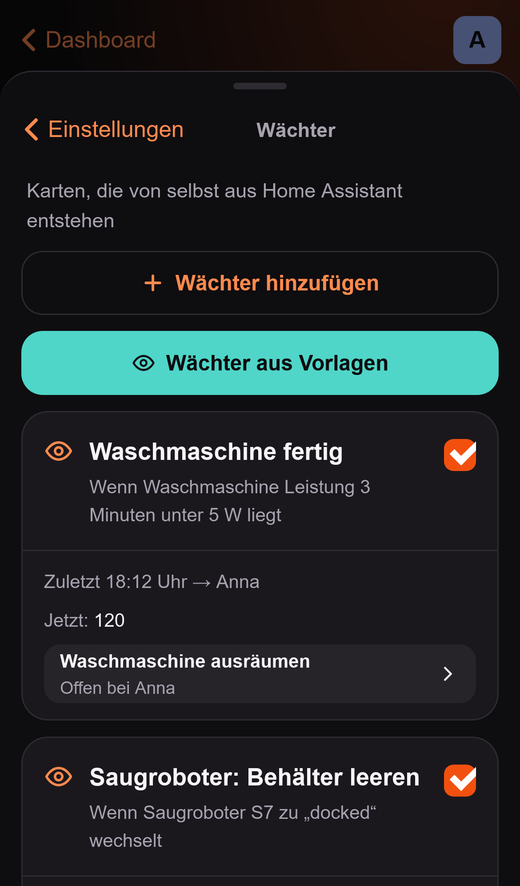
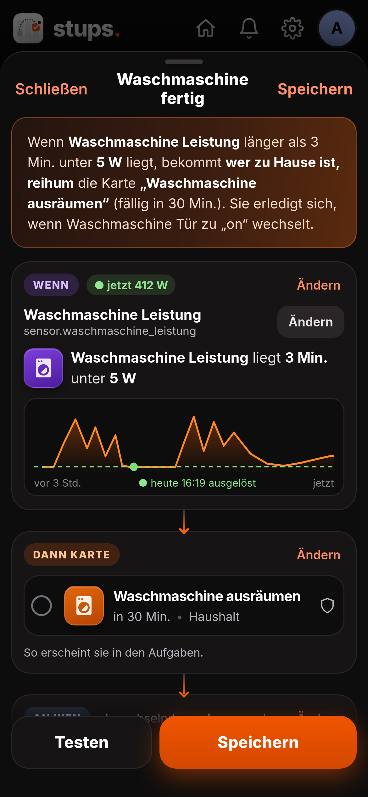
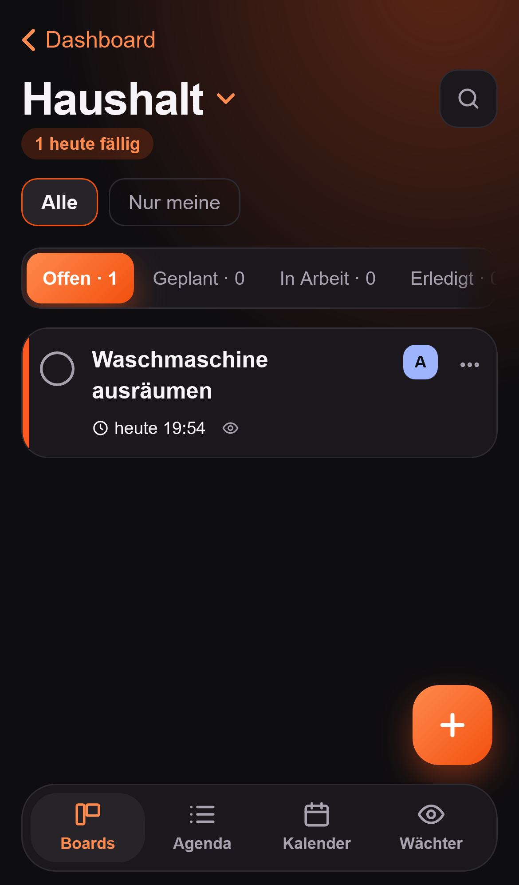

# Stups

> Deutsche Fassung. Die englische Fassung ([DOCS.md](DOCS.md)) ist maßgeblich.

Dein Zuhause merkt, was zu tun ist, ihr entscheidet, wer es macht. Stups läuft direkt in Home Assistant (Ingress, kein eigener Login): Wächter machen aus dem, was dein Smart Home weiß, Aufgaben; Boards, wiederkehrende Aufgaben, Push-Erinnerungen mit „Erledigt"-Button, Stupse und Live-Sync zwischen allen Geräten übernehmen den Rest.

## Erste Schritte

1. **Stups** im App-Store installieren, starten und in der Seitenleiste öffnen.
2. Auf einer neuen Installation führt die Einrichtung Administratoren in etwa drei Minuten durch: Wer wohnt hier, ein erster Wächter, eine Testnachricht. Jeder Schritt lässt sich überspringen und später nachholen.
3. Personen, Handys und Zugriff pflegst du in der App unter **Einstellungen › Haushalt › Personen & Zugriff**; das Dashboard für den Knopf „‹ Dashboard“ unter **Einstellungen › Home Assistant › Dashboard**.
4. Karten legst du auf dem Reiter **Boards** mit dem **+** an, oder ein Wächter legt sie aus dem an, was dein Smart Home weiß.

## Wenn etwas nicht klappt

- **Keine Push-Nachricht:** **Einstellungen › Hilfe und Daten › Warum kommt nichts an?** öffnen und unter **Einstellungen › Haushalt › Personen & Zugriff** ein Gerät für die Person ankreuzen.
- **„Kein Zugriff“:** Ein Administrator gibt dich unter **Einstellungen › Haushalt › Personen & Zugriff** frei.
- **Alles andere:** Die Diagnose-Seite (Einstellungen › Diagnose-Seite) zeigt den erkannten Benutzer und die Verbindung zu Home Assistant. Mehr unter „Fehlersuche“ weiter unten.

## Einrichtung

**Erster Start:** Auf einer neuen Installation führt Stups Administratoren zuerst durch eine kurze Einrichtung, etwa drei Minuten: **Wer wohnt hier?** (die Personen aus Home Assistant sind vorgewählt, Handys erkennt Stups selbst, wer kein Handy hat, bekommt einen Link zur Companion App im App Store oder bei Google Play, und du legst fest, wer ein Kind ist; ein Administrator ist keine Person und steht nur dabei, wenn er „Mich auch hinzufügen“ einschaltet), **Dein erster Wächter** (genau dieselbe Liste und derselbe Assistent wie unter Wächter › Gefunden, mit den eben gewählten Personen schon ausgewählt), **Testnachricht** (ein echtes Beispiel der Nachricht zu einer neuen Karte, an das Handy einer Person deiner Wahl; auf dem iPhone die Nachricht gedrückt halten, dann erscheint der Knopf *Erledigt*) und **Fertig**. Jeder Schritt lässt sich überspringen und später in den Einstellungen nachholen. Wo du aufgehört hast, merkt sich der Server: Du kannst auf einem anderen Gerät weitermachen. Mitglieder und Kinder sehen eine Kurzfassung (**Handy verbinden**, **Farbe wählen**). Bestehende Installationen zeigen sie nicht von selbst; *Einstellungen › Hilfe und Daten › Einrichtung nochmal durchgehen* öffnet sie jederzeit. Die Liste unten ist das, was die Einrichtung tut, so findest du es in den Einstellungen.

1. App starten und in der Seitenleiste **Stups** öffnen.
2. **Avatar oben rechts › Haushalt › Personen und Kinder** öffnen (Administratoren):
   - **Personen hinzufügen:** Die Personen aus Home Assistant (Einstellungen › Personen) stehen zur Auswahl. Wer hinzugefügt ist, kann zugewiesen werden und bekommt Push-Nachrichten.
   - **Push-Geräte wählen:** Pro Person die Geräte ankreuzen, auf denen die Nachrichten ankommen sollen. Es erscheinen die Geräte, auf denen die Home-Assistant-Companion-App angemeldet ist. Jede Person wählt ihre Geräte selbst, ein Administrator kann es auch für andere tun.
   - **Zugriff festlegen:** *Alle in Home Assistant* (jeder Home-Assistant-Benutzer darf die App öffnen) oder *Nur diese Personen* (nur die Liste und Administratoren; wer sonst öffnet, sieht „Kein Zugriff" und steht für Administratoren unter „Wartet auf Freigabe").
3. Unter **Einstellungen › Home Assistant › Dashboard und Kopfzeile** das Dashboard für den Knopf „‹ Dashboard" oben links wählen.
4. **Einstellungen › Für mich › Sprache und Farbe:** Automatisch (folgt dem Gerät), Deutsch oder English. Die Wahl gilt für dich auf allen Geräten, auch für Push-Nachrichten.
5. **Einstellungen › Für mich › Sprache und Farbe:** Auf dem Farbkreis den Lieblingsfarbton wählen (Grün und Türkis fehlen: Türkis gehört dem Haus, siehe „Aufgaben"). Knöpfe, aktiver Reiter und farbige Schrift folgen sofort, es gilt für dich auf allen Geräten. „Orange (Standard)“ stellt das ursprüngliche Aussehen wieder her.

### Rollen

- **Administrator** ist, wer es in Home Assistant ist. Administratoren ändern Personen, Zugriff und Dashboard und kommen immer hinein.
- **Mitglieder** benutzen die App und wählen ihre eigenen Push-Geräte.
- **Kinder** sind Personen mit eingeschränkten Rechten (siehe „Rolle Kind und Bestätigung“). Ein Administrator ist nie ein Kind.
- Wer aus der Liste entfernt wird, verliert Zuweisungen und Nachrichten, die Karten bleiben unverändert. Kommt die Person zurück, gilt alles wieder.

## Benutzung

- **Boards** wählst du im Reiter Boards (die Liste zeigt nur Boards; darunter „Neues Board", „Board-Einstellungen" und „Archivierte Boards"). Jedes Board hat eigene Spalten und Kategorien und eine **Sichtbarkeit**: *Nur ich* (sonst sieht es niemand, auch kein Administrator), *Alle in Stups* oder *Ausgewählte Personen*. In den Board-Einstellungen stehen außerdem Name, Symbol, ob das Board zur Fairness zählt, und die Reihenfolge. Ein Board lässt sich **archivieren**, **duplizieren** oder als Vorlage speichern; beim Löschen stehen vorher Aufgaben, wiederkehrende Aufgaben, Wächter und Erinnerungen in der Liste, und je Wächter wählst du Pausieren, Umziehen oder Löschen. Kategorien legst du am einfachsten direkt an der Karte an (Feld „Kategorie" › „Neue Kategorie"); Umbenennen, Umfärben und Löschen geht unter Board-Einstellungen.
- **Karten** haben Titel, Spalte, Zuständige, Fälligkeit (immer mit Uhrzeit), Wiederholung, Erinnerung, Priorität, Kategorien, Kosten, Beschreibung, Checkliste, Links, Anhänge und Kommentare.
- **Erledigen**: Kreis links an der Karte, „Erledigt" oben im Karten-Fenster oder aus der Push-Nachricht. Einen Moment lang gibt es „Rückgängig".
- **Wischen**: Finger nach links schiebt die Karte in den nächsten Status, nach rechts in den vorigen. Hinter der Karte steht, wohin sie springt. „Geplant" wird übersprungen.
- **Verschieben und mehr**: über „⋯" an der Karte (Verschieben nach …, Erledigt, Duplizieren, Details, Löschen). Auf großen Bildschirmen lassen sich Karten mit der Maus ziehen.
- **Geplant**: Karten mit Termin nach heute stehen in „Geplant" und rücken am Tag der Fälligkeit nach „Offen". So bleibt „Offen" übersichtlich. Pro Board lässt sich einstellen, welche Spalte „Geplant" und welche „Erledigt" ist.

### Karten schnell anlegen

Im Fenster **Neue Karte** genügt eine Zeile. Stups liest Datum, Uhrzeit, Wiederholung, Personen, Kategorie und Priorität heraus, der Rest ist der Titel:

```
Müll raus morgen 19 Uhr @Ben #Haushalt jede Woche !!
```

ergibt die Karte „Müll raus", fällig morgen 19:00, zuständig Ben, Kategorie Haushalt, jede Woche, Priorität hoch. Erkannte Teile sind im Text farbig hinterlegt, darunter zeigen **Chips**, was verstanden wurde. **Ein Tipp auf einen Chip nimmt ihn zurück** (der Text bleibt dann im Titel, zum Beispiel wenn „Montag" zum Titel gehört). Was du unter dem Titel von Hand änderst, überschreibt die Zeile nicht mehr.

| Was | Beispiele |
|---|---|
| Datum | `heute`, `morgen`, `übermorgen`, `Freitag`, `nächsten Montag`, `in 3 Tagen`, `in 2 Wochen`, `in einem Monat`, `1.12.`, `1.12.2027`, `1. Dezember`, `am 24. März` |
| Uhrzeit | `19 Uhr`, `19:30`, `um 19`. Steht nur ein Datum da, gilt die **Standard-Uhrzeit** (Einstellungen › Haushalt › Termine, Vorgabe 09:00) |
| Wiederholung | `jeden Tag`, `täglich`, `jede Woche`, `wöchentlich`, `alle 2 Tage`, `alle 3 Wochen`, `jeden Montag`, `monatlich`, `jährlich` |
| Person | `@Ben` (ein eindeutiger Anfang genügt: `@be`) |
| Kategorie | `#Haushalt` (aus dem aktuellen Board; eine neue wird nach Rückfrage angelegt) |
| Priorität | `!` mittel, `!!` oder `wichtig` hoch (`!` nur als eigenes Wort: „Achtung!" bleibt Titel) |

Gut zu wissen: Ein **Wochentag** allein meint den nächsten nach heute (ist heute Montag, ist „Montag" der Montag in einer Woche). Ein **Datum ohne Jahr** meint die nächste Wiederkehr. Schreibst du nur „heute" und die Standard-Uhrzeit ist schon vorbei, bekommt der Termin die nächste volle Stunde. Passt eine `@Person` nicht (unbekannt oder mehrdeutig), wartet das Anlegen, bis du den Namen änderst oder den Chip antippst, weil sonst keine Erinnerung käme.

### Aussehen

Dunkel und hell folgen dem iPhone (oder dem Gerät). Ein farbiger **Balken links** an jeder Karte zeigt die Dringlichkeit: rot überfällig, orange heute, gelb in den nächsten zwei Tagen, grau später. Die Karte zeigt den Titel (höchstens zwei Zeilen) und **eine Zeile** mit dem Wichtigsten: Termin (rot, wenn überfällig), Wiederholung, Priorität als Flagge (orange mittel, rot hoch), Checkliste („1/2"), Kommentare, Links, Anhänge und Kosten. **Kategorien** stehen als kleine farbige Punkte rechts. Wann die Karte entstanden ist („Angelegt …"), steht im Karten-Fenster mit Uhrzeit und Person.

### Die Reiter und die Kopfzeile

Die Leiste unten hat drei Reiter: **Aufgaben** (der Start: die App öffnet immer dort, nur Boards merkt sie sich), **Boards** und **Wächter**. Kinder und der Container ohne Home Assistant sehen Wächter nicht. Oben steht auf jedem Reiter dieselbe Kopfzeile: links **„‹ Dashboard"** (nur im Add-on; führt zurück zum Home-Assistant-Dashboard), rechts ein **Offline-Hinweis**, wenn die Verbindung fehlt, die **Glocke** (mit kleiner Zahl, wenn etwas auf dich wartet) und dein **Avatar**. Der Avatar öffnet die Einstellungen. Er zeigt dein Bild (aus Home Assistant oder selbst hochgeladen) oder sonst deine Initiale in deiner Farbe.

**Am Computer (ab 1024 px Breite)** ersetzt eine feste Seitenleiste die Leiste unten (Reiter, Boards, deine Karte). Die Kopfzeile hat Suche (**Strg/Cmd + K**), **Neue Aufgabe**, Home und Glocke. Aufgaben öffnen in einer Detailspalte rechts, Boards sind ein Kanban über die volle Breite, Wächter eine Tabelle, Fenster öffnen als Dialog in der Mitte. Handy und Companion App sehen aus wie bisher; Tablets zeigen die Handy-Ansicht zentriert.

Zwei Farben: Dein **Akzent** (Orange, wenn du keinen wählst) gehört den Menschen und Aktionen; **Türkis** gehört allem, was vom Haus kommt (Wächter-Karten, Wächter). Darum fehlen im Farbkreis Grün und Türkis.

### Aufgaben

Aufgaben ist die Startseite und zeigt auf einen Blick, was für dich dran ist, von oben nach unten:

- **Deine Zahlen:** heute fällig, überfällig, heute erledigt. Antippen öffnet ein Blatt (bei überfällig „Morgen" und „Alle verschieben", bei heute erledigt „Rückgängig").
- **Diese Woche:** eine Wochenleiste mit Punkten; der Kalender-Knopf öffnet den Kalender (siehe unten).
- **Stups-Banner**, nur wenn dich jemand gestupst hat und es noch offen ist.
- **Chips:** *Meine* (hier startet die App immer), *Alle*, jede Person und **Filter**.
- **Vom Haus** (nur wenn es etwas gibt): offene Karten von Wächtern, die dir zugewiesen sind oder noch niemandem. Jede zeigt, wer sie ausgelöst hat und wann („Waschmaschine fertig · vor 4 Min."), und warum du dran bist („reihum unter allen, die zu Hause sind"). Knöpfe: **Erledigt**, **Weitergeben** (an die nächste Person der Rotation, ohne dass die Karte erledigt zählt) und bei „Erst vorschlagen" **Übernehmen**.
- **Deine Karten**, gruppiert nach **Überfällig**, **Heute**, **Diese Woche** und **Später**. Die Uhrzeit ist rot, wenn überfällig, und in der Akzentfarbe, wenn sie heute ansteht.
- **Fairness diese Woche** und **Bei den anderen:** eine Zeile mit den Avataren und der Zahl offener Karten. Sie führt zu **Diese Woche**.

Ein Kind sieht nur „Vom Haus" (eigene Karten) und seine eigenen Karten. Ist nichts offen, steht dort ein freundlicher Satz.

### Diese Woche: Wer macht wie viel?

Über „Bei den anderen" auf Aufgaben erreichst du **Diese Woche** (oder diesen Monat). Sie zeigt, wie viele Karten jede Person erledigt hat, als Balken für den *Aufwand*. Es gibt **keine Rangliste**: keine Plätze, keine Medaillen, keine Prozente, die Reihenfolge ist die der Personenliste, alle Balken haben dieselbe Farbe. Es geht darum, die Last zu sehen, nicht um einen Wettbewerb.

- **Aufwand:** Jede Karte hat einen optionalen *Aufwand* (klein = 1, mittel = 2, groß = 3). Ohne Angabe zählt sie wie mittel. Eine große Aufgabe wiegt mehr als eine kleine.
- Unter dem Balken stehen, wenn es welche gibt, die angelegten Karten, beantwortete Stupse und erledigte Wächter-Karten. Eine Zeile sagt, wie viele Karten diese Woche **vom Haus** kamen. Hat jemand **wenig Zeit**, steht es dabei.
- **Wartet auf dich:** Bestätigungen von Kindern, die du geben darfst, mit **Passt** und **Nochmal**.
- Karten von Kindern mit Bestätigung zählen erst **nach** der Bestätigung. Kinder sehen die Seite nicht.
- **Sonntags-Zusammenfassung (optional):** Jede Person kann unter *Einstellungen › Für mich › Benachrichtigungen* eine Nachricht am Sonntagabend einschalten (ab 18:00, nicht in der Ruhezeit): „Diese Woche habt ihr 14 Aufgaben erledigt." Sie ist aus, bis jemand sie einschaltet, und sagt nie „0".
- **Wenig Zeit:** Wer eine stressige Woche hat, trägt unter *Einstellungen › Für mich › Benachrichtigungen* ein Datum ein (bis zu 90 Tage). Bis dahin überspringen die Rotationen der Wächter diese Person. Von Hand kann man ihr weiter Karten zuweisen. Administratoren tragen es auch für andere ein.

### Kalender

Der Kalender ist eine Seite unter Aufgaben (öffnen mit dem Kalender-Knopf der Wochenleiste oder „Monatsansicht"; „‹ Aufgaben" führt zurück). Er zeigt die Karten mit Termin als **Tag**, **Woche** oder **Monat**; die **Liste** ist die Aufgaben-Seite selbst. Mit den Pfeilen blätterst du, „Heute" springt zurück.

- **Tag und Woche** zeigen ein Zeitraster. Eine Karte steht zur Uhrzeit ihres Termins in der Farbe ihres Boards; Karten zur selben Zeit stehen nebeneinander. Ein Tipp öffnet die Karte, ein Tipp auf die Tageszahl in der Wochenansicht öffnet den Tag.
- **Monat:** Punkte (am großen Bildschirm die Titel) zeigen, wo etwas ansteht. Ein Tipp auf einen Tag öffnet die Tagesansicht.
- **Karte anlegen:** Auf einen freien Zeitpunkt im Raster tippen. Es öffnet sich ein kurzes Formular mit dem Termin: Titel, Board und Zuständige wählen, „Anlegen". Ist im Filter genau ein Board oder eine Person gewählt, sind sie vorbelegt. „Alle Felder …" öffnet das volle Formular.
- **Liste (die Aufgaben-Seite):** alle Karten mit Termin aus allen Boards, nach Tagen sortiert: zuerst **Überfällig**, dann Heute, Morgen und jeder weitere Tag. Mit dem Kreis links erledigst du eine Karte, ein Tipp öffnet sie. Sie lädt die nächsten 60 Tage; liegt in dieser Zeit nichts an, schaut sie gleich ein Jahr voraus, und **„Weitere 60 Tage laden"** holt weiter entfernte Karten.
- **Filter:** Der Knopf „Filter" oben rechts (in der Liste: die Chips darüber) filtert nach **Personen** (du selbst, jede weitere Person, „Niemand" für Karten ohne Zuständige) und **Boards**; **Erledigte** blendet die der letzten sieben Tage ein, „Zurücksetzen" löscht alle Filter. Der Filter wird auf dem Gerät gemerkt.

### Wiederkehrende Aufgaben

- **Fester Rhythmus** (z. B. jeden Samstag): Der nächste Termin richtet sich nach dem Plan, nicht nach dem Erledigen. Wer am Montag erledigt, was am Samstag fällig war, bekommt den nächsten Samstag.
- **Nach Erledigung** (z. B. Filter alle 3 Monate): Der nächste Termin ist das Erledigungsdatum plus Intervall.
- **Stündlich** (auf Wunsch nur in einem Zeitfenster, z. B. 8:00 bis 20:00) für Aufgaben, die mehrmals am Tag wiederkehren.
- **Kleine Verspätung ist okay:** wöchentliche und monatliche Regeln dürfen ein paar Tage zu spät erledigt werden, bevor der Plan neu beginnt (Toleranz in Tagen). Jede Option zeigt ein Beispiel live.
- **Ohne Termin:** Die Wiederholungs-Zeile ist immer antippbar; der erste Termin wird dann automatisch gesetzt.
- **Beim Erledigen** (in der App, per Wischen, durch Ziehen nach „Erledigt" oder aus der Push-Nachricht) bleibt die Karte **in „Erledigt"** und wiederholt sich nicht mehr. Dort steht, wann sie erledigt wurde, und sie behält alles: Kommentare, Fotos, Checkliste und Verlauf. Gleichzeitig entsteht eine **neue Karte** mit dem nächsten Termin, oben in „Offen" oder, bei einem Termin nach heute, in „Geplant". Im Verlauf der neuen Karte steht „Aus Wiederholung angelegt".
- **Was die neue Karte übernimmt:** Titel, Zuständige, Kategorien, Priorität, Wiederholung und Erinnerungen immer. Beschreibung, Checkliste (alle Einträge wieder offen), Links, Kosten, Fotos und PDFs sowie Kommentare lassen sich pro Karte im Feld **Wiederholen** unter „Für die nächste Karte übernehmen" ein- oder ausschalten. Ohne eigene Wahl werden Beschreibung, Checkliste, Links und Kosten mitgenommen, Fotos und Kommentare nicht. Übernommene Fotos teilen sich die Datei mit der erledigten Karte.
- **„Rückgängig"** (kurz nach dem Erledigen) macht beides wieder gut: Die Karte ist wieder offen, die neue verschwindet. Das geht nicht mehr, sobald die neue Karte selbst erledigt wurde.
- Ein Hinweis zur Wiederholung: Nach dem Erledigen liegt der nächste Termin auf der **neuen** Karte. Wer den Termin ändern will, tut das dort, nicht an der erledigten Karte.

### Benachrichtigungen

Empfänger sind immer die **zugewiesenen** Personen. Karten ohne Zuweisung oder ohne Fälligkeit melden sich nicht. Beim Anlegen einer neuen Karte ist deshalb die anlegende Person vorausgewählt, und wer bei einer Karte ohne Zuständige einen Termin setzt, bekommt einen Hinweis mit „Mir zuweisen". Ob für eine Karte eine Nachricht kommt, zeigt Einstellungen › Hilfe und Daten › „Warum kommt nichts an?" › „Stand anzeigen".

- zur Fälligkeit, optional vorab (15 Min. bis 2 Tage vorher) und täglich nachhaken, solange überfällig
- jeden Morgen eine Zusammenfassung mit den eigenen Aufgaben
- Auf dem iPhone erscheint der Button **„Erledigt"**, wenn man die Nachricht aufklappt (nach links wischen und „Ansicht", herunterziehen oder lange drücken)
- Nach einem Neustart werden verpasste Erinnerungen bis 12 Stunden zurück nachgeholt, ohne Doppelungen

### Sich selbst stupsen

An einer Aufgabe schaltest du **„Nochmal erinnern, wenn nicht erledigt"** ein: nach X, alle X wiederholen, höchstens N ×. Es gilt nur für dich. Wächter können die Zuständigen genauso stupsen, nach einer Zeit, wiederholt, mit Höchstzahl.

### Stupsen

Mit **Stupsen** gibst du einer anderen Person zu einer Karte einen freundlichen Stups („Denkst du dran?"). Der Knopf steht im Karten-Fenster und im Menü „⋯" jeder Karte. Das gilt für alle Personen, die unter Einstellungen › Haushalt › Personen und Kinder stehen.

1. **An wen:** Zuständige der Karte (außer dir) sind vorausgewählt. Gibt es keine, wählst du selbst. Wer kein Push-Gerät hat, steht ausgegraut mit Hinweis.
2. **Nachricht:** eine der vier Vorlagen oder ein eigener Text mit bis zu 120 Zeichen (er ersetzt die Vorlage).
3. **Stups senden.** Die Karte hüpft kurz, ein Hinweis bestätigt es.

Die Person bekommt eine Push-Nachricht mit drei Knöpfen (auf dem iPhone die Nachricht aufklappen):

- **Erledigt** erledigt die Karte wie der bekannte „Erledigt"-Knopf, bei einer Wiederholung entsteht die neue Karte.
- **Mach ich** schickt dem Absender „macht's 👍".
- **Später** stellt den Stups in einer Stunde noch einmal zu, höchstens dreimal. Danach fehlt der Knopf. Der Absender erfährt davon nichts, im Verlauf der Karte steht es.

Erledigt jemand die Karte (egal wo), bekommt jeder Absender eines offenen Stupses „… hat erledigt ✓", außer er hat sie selbst erledigt. Rückmeldungen kommen leise.

**Damit es nie nervt:**

- Pro Karte, Absender und Empfänger geht höchstens **ein Stups alle 30 Minuten**. Das Sheet zeigt „wieder ab 14:32".
- **Ruhezeit** (Vorgabe 22:00 bis 07:00): Stupse an eine Person in ihrer Ruhezeit werden zum Ende zugestellt. Der Absender sieht „wird um 07:00 zugestellt". Jede Person stellt ihre Ruhezeit selbst ein (Einstellungen › Für mich › Benachrichtigungen) oder schaltet sie aus. Die Ruhezeit gilt nur für Stupse, nicht für Erinnerungen zur Fälligkeit.
- Wird die Karte erledigt oder gelöscht, bevor ein wartender Stups zugestellt ist, entfällt er.
- Man kann sich nicht selbst stupsen. Dafür gibt es Fälligkeit und Vorab-Erinnerung.

An der Karte zeigt ein orangefarbenes Abzeichen „Conny stupst dich", wenn dich jemand gestupst hat, und ein dezenter Hinweis „Du hast Conny gestupst" bei deinen eigenen. Der Filter **Gestupst** über der Liste zeigt die Karten mit einem offenen Stups an dich. „Stand anzeigen" in den Einstellungen listet die Stupse mit ihrem Stand.

### Haus-Kanäle: Ansagen und Lampen

Ein Stups (und wenn du magst eine Fälligkeits-Erinnerung oder eine Wächter-Karte) kann **im Haus** ankommen statt auf dem Handy. Gedacht für Kinder ohne Handy und für alle, die zu Hause sind und nicht auf einen Bildschirm schauen. Es braucht die Verbindung zu Home Assistant.

Administratoren richten es ein: Einmal unter **Einstellungen › Home Assistant › Ansage und Lampe** den Sprachdienst wählen, dann unter **Haushalt › Personen und Kinder** eine Person aufklappen und unter **Haus** Kanäle hinzufügen:

- **Ansage:** ein Lautsprecher (`media_player`). Stups sagt zum Beispiel: „Ben, Anna stupst dich: Müll rausbringen. Denkst du dran?" Du kannst eine Lautstärke einstellen; danach geht der Lautsprecher auf die vorherige zurück.
- **Lampe:** eine Lampe, die fünf Sekunden in der Akzentfarbe der Person leuchtet und dann wieder so ist wie vorher (auch wenn sie aus war).

Jeder Kanal lässt sich einzeln ein- und ausschalten. Je Kanal wählst du, **welche Nachrichten ankommen** (Stupse, Fälligkeiten, Wächter-Karten; ein neuer Kanal hat nur Stupse) und **was geschieht, wenn die Person nicht zu Hause ist**: die Nachricht *verwerfen* oder *warten, bis die Person heimkommt* (mit einer Frist in Minuten; ist die Karte inzwischen erledigt oder der Stups beantwortet, entfällt sie). **Testen** probiert den Kanal sofort aus.

Gut zu wissen:

- Es gilt die **Ruhezeit** der Person: Stupse warten, bis sie vorbei ist, Fälligkeits-Erinnerungen und Wächter-Karten entfallen in dieser Zeit.
- „Zu Hause" kommt von der Person in Home Assistant (zugeordnet über den Benutzer, sonst über den Namen). Passt keine, behandelt Stups die Person als zu Hause, und die Einstellungen weisen darauf hin.
- Wer nur einen Haus-Kanal hat, kann trotzdem gestupst werden und Karten zugewiesen bekommen.
- Was mit laufender Musik geschieht, bestimmt der Lautsprecher: Manche senken die Lautstärke, manche pausieren, manche spielen weiter. Eine Lampe ohne Farbe leuchtet einfach weiß.
- In einer Haus-Nachricht gibt es keine Knöpfe. Erledigt wird in der App.
- In der **Beta** bleiben die Haus-Kanäle still, bis Push eingeschaltet ist (Einstellungen › Beta), damit nichts doppelt angesagt wird.
- Die Übersicht unter Einstellungen › Hilfe und Daten › Warum kommt nichts an? zeigt jeden Kanal mit dem letzten Ergebnis.

### Rolle Kind und Bestätigung

Administratoren machen eine Person unter *Einstellungen › Haushalt › Personen und Kinder › Rolle Kind* zum **Kind**. Ein Kind bekommt eine reduzierte App, und der Server setzt das durch (nicht nur der Bildschirm):

- Ein Kind **sieht** alle Boards, die es sehen darf, oder nur die **Boards mit eigenen Karten** (Wahl je Kind) und kann eigene Karten **abhaken**, Checklistenpunkte abhaken, **kommentieren** und **Fotos und Links anhängen**. Außerdem darf ein Kind **„Nur ich"-Boards** für sich anlegen. Sonst nichts: kein Anlegen von Karten auf geteilten Boards, kein Verschieben, Löschen, keine Verwaltung geteilter Boards, keine Wächter, keine Fairness, keine Einstellungen außer Sprache und Farbe.
- **Bestätigung:** Je Kind kannst du *„Erledigt“ braucht eine Bestätigung* einschalten, je Karte lässt es sich überschreiben (*Bestätigung*: Vorgabe der Person, immer, nie). Hakt das Kind eine Karte ab, bleibt sie offen und zeigt **„Wartet auf Bestätigung“**. Die **Bestätiger** bekommen eine Push-Nachricht mit **Bestätigen** und **Nochmal**:
  - *Bestätigen* erledigt die Karte. Sie zählt für das **Kind** (Wiederholung, Fairness, Wächter-Zähler).
  - *Nochmal* nimmt die Anfrage zurück. Das Kind bekommt „Nochmal, bitte“ (aufs Handy und, wenn ein Haus-Kanal eingerichtet ist, als Ansage im Haus, außer in der Ruhezeit).
  - Wer zuerst antwortet, entscheidet; die anderen sehen, dass schon geantwortet wurde. Unbeantwortete Anfragen erinnern die Bestätiger nach zwei Stunden, höchstens einmal am Tag.
- **Wer bestätigt:** Administratoren immer; dazu die Personen, die du je Kind wählst. Ist niemand gewählt, dürfen alle Erwachsenen.
- Wer eine wartende Karte anders erledigt (ein Erwachsener in der App), beendet die Anfrage.

### Berechtigungen und Feedback

Ein Administrator kann einzelnen Personen gezielt Rechte geben, ohne sie zu Administratoren zu machen: Wächter, Ansage und Lampe, App-Einstellungen, Personen, Bestätigen für Kinder und Feedback lesen (*Einstellungen › Personen und Kinder › Person öffnen › Berechtigungen*). **Feedback** (Fehler melden, Verbesserung vorschlagen, loben oder kritisieren, bis zu 1000 Zeichen, optional Bild) schickst du direkt aus der App; Administratoren lesen es unter *Einstellungen › Hilfe und Daten*. Es bleibt auf deiner Installation.

### Einstellungen

Der Avatar oben rechts öffnet die Einstellungen als Übersicht mit Unterseiten. Oben stehen dein Bild, dein Name und woher das Bild kommt; **Bild ändern** lädt ein eigenes hoch (JPEG, PNG oder WebP bis 2 MB, wird auf dem Gerät auf 256 Pixel verkleinert), **Bild entfernen** geht zurück zum Bild aus Home Assistant oder zur Initiale. Ist deine Person einer Person in Home Assistant zugeordnet und hat diese ein Bild, holt Stups es von dort (nie direkt im Browser, immer über Stups). Ein hochgeladenes Bild hat Vorrang. Administratoren ändern das Bild auch für andere.

| Gruppe | Seiten |
|---|---|
| **Für mich** (alle) | Benachrichtigungen (Test an mich, meine Geräte oder ntfy-Thema, Ruhezeit, Sonntagsrückblick, Wenig Zeit) · Sprache und Farbe · Konto und Anmeldung (nur im Container) |
| **Haushalt** (Administratoren) | Personen und Kinder · Wächter · Vorlagen (Board-Vorlagen) · Termine (Standard-Uhrzeit) |
| **Home Assistant** (Administratoren) | Dashboard und Kopfzeile (Zurück-Dashboard, HA-Kopfzeile ausblenden, Bubble-Card-Knopf) · Ansage und Lampe (Sprachdienst) |
| **Hilfe und Daten** | Warum kommt nichts an? · Papierkorb, Archiv, Umzug · Beta (nur in der Beta) · Einrichtung nochmal durchgehen |

Am Fuß stehen die Version und der Link zur Diagnose-Seite. Mitglieder sehen „Haushalt" und „Home Assistant" nicht; ein Kind sieht nur „Sprache und Farbe". Die Wahl „HA-Kopfzeile ausblenden" gilt nur für das Gerät; Mitglieder finden sie unter *Sprache und Farbe*.

### Board-Vorlagen

Beim Anlegen eines Boards (Reiter Boards › Neues Board) startest du **leer** oder aus einer **Vorlage**, mit Vorschau auf Spalten, Kategorien und Karten. Eingebaut sind *Haushalt, Umzug, Renovierung, Urlaub packen, Baby kommt, Ideen und Unternehmungen*, in der Sprache deiner App. Unter *Board-Einstellungen › Vorlagen* kannst du ein Board **als Vorlage speichern** (Spalten, Kategorien und offene Karten, ohne Zuweisungen, Anhänge und Kommentare) und eigene Vorlagen löschen.

### Wächter: Karten automatisch aus Home Assistant

Ein Wächter beobachtet eine Entität in Home Assistant und legt **von selbst eine Karte an und weist sie zu**, sobald etwas passiert. Das Standardbeispiel: Die Waschmaschine ist fertig, und eine Person, die gerade zu Hause ist, bekommt die Karte „Waschmaschine ausräumen" (fällig in 30 Minuten) samt Push-Nachricht. Wächter einrichten und ändern dürfen nur **Administratoren** von Home Assistant, alle Personen sehen sie.



**Der Reiter Wächter zeigt den Zustand, nicht die Regeln.** Der Reiter **Wächter** (dritter Reiter, für alle Erwachsenen) sortiert die Wächter nach dem, was gerade los ist: **Wartet auf jemanden** (eine Karte ist offen: wer ist dran, seit wann, Knopf **Stupsen**), **Läuft gerade** (die Maschine läuft: seit wann, welche Karte danach kommt), **Bald dran** (der Zähler steht auf „2 von 3", oder ein Termin im Kalender steht an) und eine Zeile **Ruhig** mit den Wächtern, die nichts melden. Fehlt die Verbindung zu Home Assistant, steht dort „Keine Verbindung zu Home Assistant seit …" (Boards und Karten funktionieren weiter). Administratoren sehen dort außerdem „Stups hat N weitere Geräte gefunden". **Ein Tipp auf einen Wächter öffnet ihn:** Administratoren bearbeiten ihn dort direkt (Satz, Mehr Regeln, Testen, Pausieren, Löschen), alle anderen sehen Einstellungen und Verlauf lesend. Unten steht die **letzte Aktivität** aller Wächter; im Wächter selbst der Verlauf seiner letzten Läufe.

**Verwalten** (Liste, An/Aus, Bearbeiten, Löschen, letzte Aktivität): *Einstellungen › Haushalt › Wächter*. Alle Erwachsenen sehen die Liste, **Administratoren** ändern sie.

**Einrichten, am leichtesten über „Gefunden":** *Einstellungen › Haushalt › Wächter › Wächter aus Vorlagen* (oder der Hinweis im Reiter Wächter). Stups sieht in Home Assistant nach und zeigt, wozu ein Wächter passt, mit Begründung („Steckdose Trockner misst die Leistung"): Waschmaschine, Trockner, Spülmaschine (Leistungssensor oder Programmstatus des Geräts), Tonnen rausstellen (Abfallkalender), Wäsche rein es regnet (Wetter), Batterie schwach, Saugroboter-Behälter. Ein Tipp auf **Einrichten** füllt den Satz aus; Entitäten, die schon ein Wächter beobachtet, fehlen. **Passt ein Vorschlag nicht** (du hast das Gerät nicht), tippe auf **Ausblenden**: Stups schlägt ihn nie wieder vor. Unter **Ausgeblendet** holst du ihn mit „Wieder anzeigen" zurück. Darunter steht **Auch ohne Gerät**: Karten, die sich von selbst wiederholen (Entkalken, Rauchmelder testen, Filter wechseln, Bettwäsche wechseln), ohne Wächter. „Alle Vorlagen ansehen" zeigt auch die, zu denen nichts gefunden wurde.



**Das Formular ist ein Satz:** „Wenn [Entität] länger als [3 Min.] unter [5 W] liegt, bekommt [wer zu Hause ist, reihum] die Karte [Titel]." Jedes Feld in eckigen Klammern tippst du an und änderst. Darunter:

- **Probelauf:** Stups holt die Historie der Entität der letzten 7 Tage (höchstens 20 000 Zustände) aus Home Assistant und rechnet die Regel darauf, ohne etwas zu speichern. Du siehst ein kleines Diagramm, wann der Wächter ausgelöst hätte, und einen Satz: „3 Auslösungen erkannt, kein Fehlalarm" oder „5 Mal ausgelöst, davon 4 innerhalb von 10 Minuten: Mindestdauer erhöhen?". Ohne Historie (Recorder aus, neue Entität) steht ein Hinweis statt des Diagramms.
- **Erst vorschlagen:** Die Karte entsteht ohne Zuständige, alle Erwachsenen, die zu Hause sind, bekommen die Frage „Wer übernimmt?" mit dem Knopf **Übernehmen** (Push) und auf Aufgaben. Wer zuerst tippt, bekommt die Karte; die anderen erfahren, wer schneller war. Meldet sich in **30 Minuten** niemand, greift der Rückfall des Wächters. Ist niemand zu Hause, greift er sofort.
- **Ehrlich beim Selbst-Erledigen:** Ein Leistungssensor kann nicht belegen, dass jemand das Gerät ausgeräumt hat. Bei Vorlagen, wo das so ist, ist „Erledigt sich selbst" aus, mit der Begründung daneben. Bei der Batterie-Vorlage erledigt sich die Karte, wenn der Sensor wieder über 50 % steigt.
- **Mehr Regeln** klappt alles Weitere auf: Name, Board, Spalte, Beschreibung, Kategorien, Priorität, Fälligkeit, wer genau infrage kommt, die Rückfälle, „Erledigt sich selbst, wenn …", Zähler, Sperrzeit, Doppelkarten, Erinnern.
- **Kalender und Wetter:** Zwei weitere Arten von Auslösern, die Stups **alle 30 Minuten** selbst abfragt. *Termin im Kalender* mit Vorlauf (zum Beispiel 12 Stunden vor der Leerung; jeder Termin bekommt genau eine Karte, ganztägige Termine beginnen um Mitternacht) und *Regen in der Vorhersage* einer Wetter-Entität (in den nächsten 1 bis 48 Stunden; nach dem Regen ist der Wächter wieder scharf). Für sie gibt es keinen Probelauf.

Die Bedingungen im Einzelnen:

1. **Wenn:** die Entität (mit aktuellem Zustand), dann die Bedingung:
   - *Wert fällt unter* oder *steigt über* eine Zahl, zum Beispiel die Leistung der Waschmaschine unter 5 W.
   - *Zustand wechselt zu* einem Wert, zum Beispiel `docked` beim Saugroboter.
   - **Für mindestens … Minuten:** Die Bedingung muss so lange ununterbrochen gelten (Vorgabe bei Zahlenwerten 3 Minuten, damit kurze Einbrüche nichts auslösen).
   - **Erst beim N-ten Mal:** Stups zählt selbst und legt die Karte erst beim N-ten Auslösen an (Saugroboter: nach 3 Reinigungen). Der Stand steht im Wächter („2 von 3"). Wird die Karte erledigt, beginnt die Zählung von vorn; „Zurücksetzen" macht das von Hand.
2. **Dann Karte:** Titel im Satz; Board, Spalte, Beschreibung, Kategorien, Priorität und Fälligkeit (keine, „in … Minuten" oder „heute/morgen um …") unter „Mehr Regeln".
3. **An wen:**
   - *Abwechselnd unter den Anwesenden*: reihum, wer in Home Assistant gerade `home` ist. Ist niemand zu Hause, entscheidet der Rückfall (nächste Person, alle, feste Person, niemand).
   - *Wer zuerst nach Hause kommt*: Ist schon jemand da, geht die Karte wie bei „abwechselnd unter den Anwesenden" sofort an eine anwesende Person. Sonst erscheint sie **ohne Zuständige und ohne Push** mit dem Hinweis „Wartet auf die erste Person, die heimkommt". Wer als Erstes heimkommt, bekommt sie und die Nachricht, die Fälligkeit zählt ab dann. Kommen mehrere innerhalb von 2 Minuten, bekommen alle die Karte. Kommt 24 Stunden lang niemand, bleibt die Karte unzugewiesen (einstellbar: an alle oder an eine feste Person).
   - *Erst vorschlagen* (siehe oben).
   - *Alle Anwesenden*, *Abwechselnd (egal, wer da ist)*, *Feste Person(en)* oder *Niemand*.
   - Rotationen überspringen Personen mit **wenig Zeit** (sind alle im Kreis beschäftigt, gilt die normale Reihenfolge).
   - **Weitergeben:** Auf Aufgaben gibt „Weitergeben" eine Karte vom Haus an die nächste Person der Rotation (gleicher Kreis, gleiche Anwesenheitsregel, ohne Beschäftigte). Die Rotation rückt dabei nicht weiter, die Karte zählt nicht als erledigt. Ist niemand sonst dran, bleibt sie bei dir.
   - Welche Person zu welcher Home-Assistant-Person gehört, erkennt Stups am Benutzer der Person, sonst am Namen. Ist die Zuordnung unklar, gilt die Person als nicht anwesend.
4. **Erledigt sich selbst, wenn …** (optional): zweite Entität und Bedingung, zum Beispiel die Tür der Waschmaschine geht auf. Die offene Karte des Wächters wird dann erledigt.

**Regeln:**
- Eine **Sperrzeit** (Vorgabe 10 Minuten) fängt flatternde Sensoren ab. Sie gilt auch für den Zähler.
- Solange die Karte des Wächters **offen** ist, entsteht keine zweite; im Verlauf der Karte steht „Erneut ausgelöst". Das lässt sich abschalten.
- **Nach … Minuten stupsen** (optional): Ist die Karte dann noch offen, bekommen die Zuständigen einmal eine Erinnerung.
- Beim **Anlegen** löst ein Wächter nicht von selbst aus, wenn die Bedingung schon erfüllt ist (ein Gerät, das schon aus ist): Stups fragt dann nach dem Speichern, ob die Karte jetzt entstehen soll („Ja, Karte erstellen“ oder „Nein, erst beim nächsten Mal“). Ausnahme sind Pegel wie Batterie, Temperatur und Luftfeuchte: Ein Wert, der schon über der Grenze liegt, ist ein Befund, die Karte kommt ohne Frage. Dasselbe gilt beim Ändern, wenn sich Entität oder Bedingung geändert haben. Nach einem Neustart von Stups oder Home Assistant wird der aktuelle Zustand abgeglichen: Ein verpasster Übergang löst **genau einmal** aus, nie doppelt. Die Angabe „von" bei Zustandswechseln lässt sich nach einem Neustart nicht mehr prüfen.
- Fehlt die Entität in Home Assistant, steht „Entität fehlt" beim Wächter, er wird nicht gelöscht. Gibt es Board oder Spalte nicht mehr, pausiert der Wächter mit Hinweis.
- Die Karte ist eine ganz normale Karte (Fälligkeits-Push, Erinnerungen, Stupsen), mit einem Auge-Symbol und dem Eintrag „Angelegt von Wächter …" im Verlauf.
- **Testen** legt die Karte einmal sofort an (Vermerk „Test"), damit du Push und Zuweisung prüfen kannst.



**Hinweis zu Waschmaschine und Trockner:** Hängen beide an derselben Steckdose, unterscheidet die Leistung allein sie nicht. Dann hilft ein eigener Sensor je Gerät (zum Beispiel ein Template-Sensor oder eine zweite Steckdose).

#### Eigene Automationen: Ereignis `stups_create_card`

Wer lieber eigene Automationen in Home Assistant baut, kann damit direkt Karten anlegen. Stups reagiert auf das Ereignis `stups_create_card`:

```yaml
automation:
  - alias: Luftreiniger-Filter wechseln
    triggers:
      - trigger: numeric_state
        entity_id: sensor.luftreiniger_filter
        below: 10
    actions:
      - event: stups_create_card
        event_data:
          board: Haushalt              # Name oder Kennung; ohne Angabe das erste Board
          column: Offen                # Name oder Kennung; ohne Angabe die erste offene Spalte
          title: Filter wechseln
          description: Luftreiniger im Wohnzimmer
          assignees: present           # Namen der Personen oder "present" für alle, die zu Hause sind
          due_in_minutes: 60           # optional
          dedupe_key: luftreiniger     # optional: keine zweite Karte, solange diese offen ist
```

Fehler (unbekanntes Board, fehlender Titel, doppelter `dedupe_key`) gehen nicht verloren: Die letzten 20 Ereignisse mit Ergebnis stehen für Administratoren auf der Diagnose-Seite (Einstellungen › Diagnose-Seite) unter „Automationen". Eigene Automationen sind so vertrauenswürdig wie Home Assistant selbst: Wer Automationen anlegen darf, kann Karten anlegen.

### Sensoren

Für Dashboard und Automationen: `sensor.stups_ueberfaellig`, `sensor.stups_heute_faellig` sowie je Person `sensor.stups_ueberfaellig_<name>` und `sensor.stups_heute_faellig_<name>`. Die Attribute `tasks` enthalten Titel, Termin und Board. Dazu `sensor.stups_stupse_offen` (alle offenen Stupse) und je Person `sensor.stups_gestupst_<name>` (offene Stupse an diese Person, mit Karte, Absender und Zeitpunkt als Attribut). `sensor.stups_waechter_offen` zählt die offenen Karten, die ein Wächter angelegt hat.

### Archiv und Papierkorb

- Erledigte Karten werden nach der Archivfrist des Boards (Standard 7 Tage) archiviert, auch die erledigten Durchgänge einer wiederkehrenden Karte. Die offene, wiederkehrende Karte wird nie archiviert.
- Gelöschtes liegt 30 Tage im Papierkorb.

### Anhänge

Fotos werden vor dem Hochladen auf höchstens 2048 Pixel verkleinert, als JPEG gespeichert und von Standortdaten befreit. PDFs bis 20 MB gehen unverändert hoch.

## Dashboard-Button (Bubble Card)

Den Pfad zeigt die App unter Einstellungen. Beispiel:

```yaml
type: custom:bubble-card
card_type: button
button_type: name
name: Stups
icon: mdi:view-column
tap_action:
  action: navigate
  navigation_path: /XXXXXXXX_stups
```

## Daten umziehen

Zieht Stups in Home Assistant auf eine andere Adresse um (anderes Repository = andere App), bleiben die Daten nicht automatisch erhalten. Sie wandern über einen Export:

1. In der bisherigen App: **Einstellungen › Hilfe und Daten › Papierkorb, Archiv, Umzug › Daten exportieren** (nur für Administratoren). Datenbank und Anhänge liegen danach in `/share/stups-umzug`.
2. Die neue Stups-App installieren und **zum ersten Mal starten**. Sie übernimmt den Export von selbst, im Log steht „Daten aus dem Umzug übernommen". Eine App, die schon eigene Daten hat, übernimmt nichts.
3. Prüfen, ob Boards, Karten, Personen und Fotos da sind. Der Dashboard-Button der neuen App hat einen eigenen Panel-Pfad (`/<Kennung>_stups`).
4. Erst danach die bisherige App deaktivieren. Bis dahin bleibt sie als Rückfallebene bestehen.

## Datensicherung

Datenbank und Anhänge liegen im Add-on-Verzeichnis `/data` und sind Teil des normalen Home-Assistant-Backups. Vor jeder Datenbank-Aktualisierung legt die App eine Kopie unter `/data/backups` an (die letzten 5 bleiben).

## Optionen des Add-ons (veraltet)

Bis Version 1.40 ließ sich alles in Home Assistant einstellen, unter **Einstellungen › Apps › Stups › Konfiguration**. So waren diese Optionen gemeint (sie sind veraltet, siehe unten):

```yaml
users:                       # Wer Stups nutzt und wohin die Push-Nachrichten gehen
  - name: Anna               # Name wie in Home Assistant (Einstellungen › Personen)
    notify:                  # Notify-Dienste der Companion App, ohne "notify."
      - mobile_app_annas_iphone
  - name: Ben
    notify:
      - mobile_app_bens_iphone
      - mobile_app_bens_ipad
access_mode: selected        # selected = nur diese Personen und Administratoren, everyone = alle Home-Assistant-Benutzer
dashboard_path: /            # Vorgabe für den Zurück-Button, später in der App änderbar
daily_summary_time: "08:00"  # Tageszusammenfassung
overdue_nag_time: "18:00"    # Nachhaken bei Überfälligkeit
```

Die Namen der Geräte findest du in Home Assistant unter Entwicklerwerkzeuge › Aktionen (Dienste `notify.mobile_app_…`); in der App zeigt Einstellungen › Haushalt › Personen und Kinder, welche Geräte Home Assistant kennt.

**Nur der erste Start liest diese Optionen.** Ab Version 1.41 übernimmt Stups Personen, Geräte, Zugriff, Dashboard und Uhrzeiten von hier einmal in die App, beim ersten Start nach dem Update, und entfernt niemanden. Danach ist die App der einzige Ort: Änderungen in dieser Konfiguration wirken nicht mehr, und Personen, Geräte und Zugriff sind in der App nicht mehr gesperrt. Pflege sie unter Einstellungen › Personen & Zugriff, Einstellungen › Dashboard, Einstellungen › Tageszusammenfassung und Einstellungen › Nachhaken um …. In einer späteren Version verschwinden die Optionen aus der Konfiguration.

## Aktualisieren

Neue Versionen erscheinen im App-Store erst, wenn ihr Docker-Image fertig ist (der Bau veröffentlicht die Version zuletzt). Ein angezeigtes Update lässt sich also installieren: „Nach Updates suchen" › Aktualisieren. Aktualisieren, **nicht** deinstallieren: Beim Deinstallieren werden alle Daten der App gelöscht.

## Fehlersuche

- **Diagnose-Seite:** `…/diagnose.html` im Panel (Einstellungen › Diagnose-Seite) zeigt erkannten Nutzer, Verbindung zu Home Assistant und Test-Push.
- **Push kommt nicht an:** Ist unter Einstellungen › Für mich › Benachrichtigungen (bei dir) oder Haushalt › Personen und Kinder (bei anderen) ein Gerät angekreuzt? „Warum kommt nichts an?" › „Stand anzeigen" zeigt, wer für welche Karte eine Nachricht bekommt. Die Diagnose-Seite markiert Dienste, die es nicht mehr gibt.
- **„Kein Zugriff" beim Öffnen:** Der Zugriff steht auf „Nur diese Personen", und du bist nicht dabei. Ein Administrator gibt dich unter Einstellungen › Haushalt › Personen und Kinder frei.
- **Panel öffnet auf dem Handy nichts:** Dann ist das Panel nur für Administratoren sichtbar. Stups gibt das Panel für alle Benutzer frei; fehlt es trotzdem, in Home Assistant bei der App „In der Seitenleiste anzeigen" prüfen.
