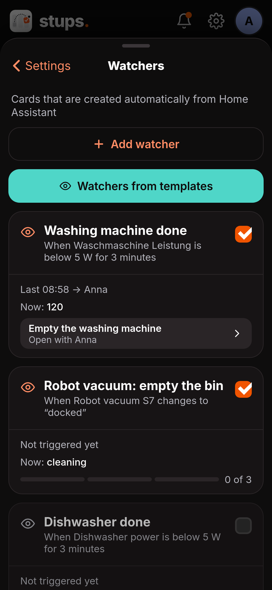
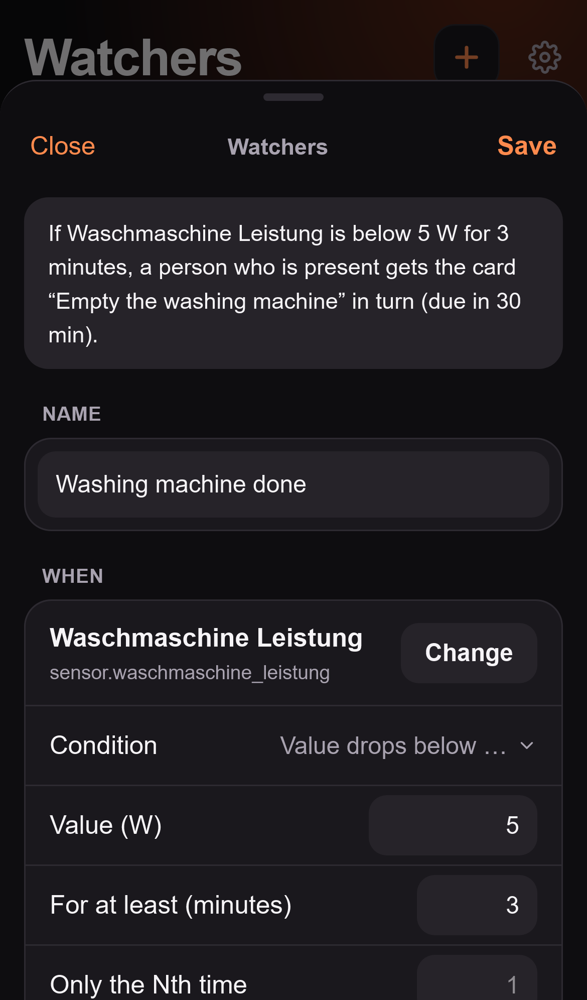
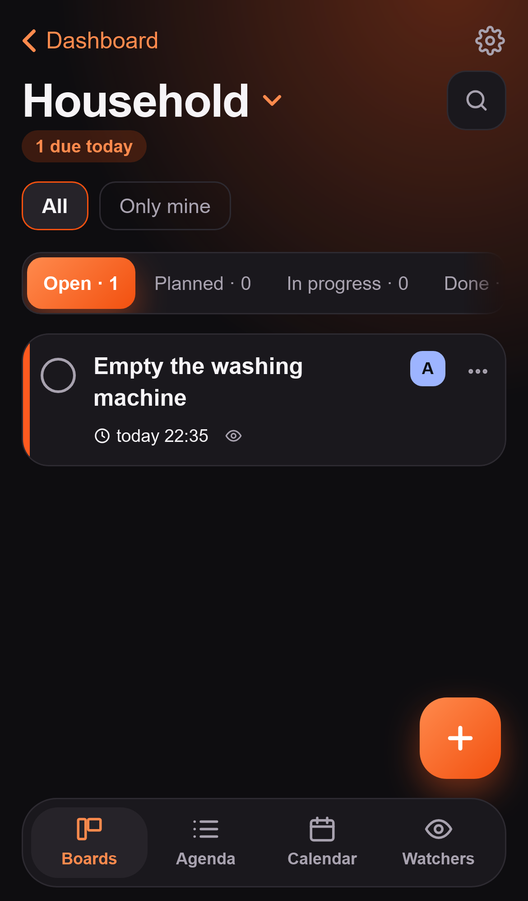

# Stups

> 🇩🇪 [Deutsche Fassung](DOCS.de.md). This English version is the authoritative one.

A Kanban board for the household, right inside Home Assistant (Ingress, no separate login). Several boards, recurring tasks, push reminders with a "Done" button and live sync between all devices.

## Setup

1. Start the app and open **Stups** in the sidebar.
2. Open **Board switcher › Settings › People & Access**:
   - **Add people:** the people from Home Assistant (Settings › People) are offered. Whoever is added can be assigned cards and receives push messages.
   - **Choose push devices:** tick, per person, the devices that should receive the messages. The devices where the Home Assistant Companion App is signed in appear. Everyone chooses their own devices; an administrator can also do it for others.
   - **Set access:** *Everyone in Home Assistant* (every Home Assistant user may open the app) or *Only these people* (only the list and administrators; anyone else who opens it sees "No access" and appears for administrators under "Waiting for approval").
3. Under **Settings › Back to the dashboard** choose the dashboard for the back button.
4. **Settings › Language:** Automatic (follows the device), German or English. The choice applies to you on all your devices, push messages included.

### Roles

- **Administrator** is whoever is one in Home Assistant. Administrators change people, access and the dashboard and always get in.
- **Members** use the app and choose their own push devices.
- Whoever is removed from the list loses assignments and messages; the cards stay unchanged. If the person comes back, everything applies again.

### Add-on options (configuration in Home Assistant)

You can also set everything in Home Assistant, under **Settings › Apps › Stups › Configuration**:

```yaml
users:                       # Who uses Stups and where the push messages go
  - name: Anna               # Name as in Home Assistant (Settings › People)
    notify:                  # Notify services of the Companion App, without "notify."
      - mobile_app_annas_iphone
  - name: Ben
    notify:
      - mobile_app_bens_iphone
      - mobile_app_bens_ipad
access_mode: selected        # selected = only these people and administrators, everyone = all Home Assistant users
dashboard_path: /            # Default for the back button, can be changed later in the app
daily_summary_time: "08:00"  # Daily summary
overdue_nag_time: "18:00"    # Follow-up for overdue cards
```

You find the device names in Home Assistant under Developer tools › Actions (services `notify.mobile_app_…`); in the app, Settings › People & Access shows which devices Home Assistant knows.

**Two ways, one result:** if at least one person is entered under `users`, **this list applies** (at every start of the app): the people named are created and get their devices, whoever is not on the list is no longer a person (their cards keep the assignment), and access follows `access_mode`. In the app, people, devices and access are then locked and can only be viewed; display name and quiet time can still be changed. Restart the app after changing the configuration. If `users` stays empty, you manage everything in the app under Settings › People & Access, and without a choice "Everyone in Home Assistant" applies.

## Usage

- **Boards** are switched by the title at the top. Each board has its own columns and categories. The easiest way to create categories is directly on the card (field "Category" › "New category"); renaming, recolouring and deleting works under Board switcher › Board settings. A new board gets the columns "Open", "Planned", "In progress" and "Done" in your language.
- **Cards** have a title, column, assignees, due date (always with a time), repeat, reminder, priority, categories, cost, description, checklist, links, attachments and comments.
- **Completing:** the circle on the left of the card, "Mark as done" at the top of the card window, or from the push message. For a moment there is "Undo".
- **Swiping:** swiping a card to the left moves it to the next status, to the right to the previous one. Behind the card it says where it will jump. "Planned" is skipped.
- **Moving and more:** via "⋯" on the card (Move to …, Mark as done, Duplicate, Details, Delete). On large screens cards can be dragged with the mouse.
- **Planned:** cards with a due date after today sit in "Planned" and move to "Open" on the due date. This keeps "Open" tidy. Per board you can choose which column is "Planned" and which is "Done".
- **Settings** are behind the **gear at the top right** of every tab.

### Creating cards quickly

In the **New card** window a single line is enough. Stups reads date, time, repeat, people, category and priority out of it; the rest is the title:

```
Take out trash tomorrow 7pm @Ben #Home every week !!
```

gives the card "Take out trash", due tomorrow 19:00, assigned to Ben, category Home, every week, high priority. Recognised parts are highlighted in colour in the text, and **chips** below show what was understood. **Tapping a chip undoes it** (the text then stays in the title, for example when "Monday" is part of the title). What you change by hand below the title no longer overwrites the line.

| What | Examples (English) |
|---|---|
| Date | `today`, `tomorrow`, `Friday`, `next Monday`, `on Friday`, `in 3 days`, `in 2 weeks`, `in a month`, `1 December`, `1st Dec`, `Dec 1`, `December 1st 2027`, `1.12.` |
| Time | `7pm`, `7:30pm`, `19:30`, `at 7`. If only a date is given, the **default time** applies (Settings › Defaults, default 09:00) |
| Repeat | `every day`, `daily`, `every week`, `weekly`, `every 2 days`, `every 3 weeks`, `every Monday`, `monthly`, `yearly` |
| Person | `@Ben` (a unique beginning is enough: `@be`) |
| Category | `#Home` (from the current board; a new one is created after confirmation) |
| Priority | `!` medium, `!!` or `important` / `urgent` high (`!` only as a word of its own: "Warning!" stays a title) |

In German the words are `morgen`, `19 Uhr`, `jede Woche`, `wichtig` and so on; the recognised words follow the language of the app.

Good to know: a **weekday** on its own means the next one after today (if today is Monday, "Monday" is the Monday in a week). A **date without a year** means the next occurrence. If you only write "today" and the default time has already passed, the due date gets the next full hour. If an `@person` does not fit (unknown or ambiguous), creating waits until you change the name or tap the chip, because otherwise no reminder would come.

### Appearance

Dark and light follow the iPhone (or the device). A coloured **bar on the left** of every card shows urgency: red overdue, orange today, yellow in the next two days, grey later. The card shows the title (at most two lines) and **one line** with the most important things: due date (red when overdue), repeat, priority as a flag (orange medium, red high), checklist ("1/2"), comments, links, attachments and cost. **Categories** appear as small coloured dots on the right. When the card was created ("Created …") is shown in the card window with time and person.

### Agenda

The bar at the bottom switches between **Boards** and **Agenda**. The agenda shows all cards with a due date from all boards, sorted by day: first **Overdue**, then Today, Tomorrow and every further day with something due. The circle on the left completes a card, a tap opens it.

At the top you filter what you want to see:

- **People:** "All", yourself ("Me"), every other person and "Nobody" (cards without assignees). You can choose several; a card appears as soon as one of the chosen people is assigned. The number on the chip says how many cards belong to it.
- **Boards:** one chip per board (with board colour). Several are possible here too.
- **Completed** shows the cards completed in the last seven days. "Reset" clears all filters. The filter is remembered on the device.

The agenda loads the next 60 days. If nothing is due in that time, it looks a year ahead right away; cards further away are fetched by **"Load 60 more days"** (also with an empty list).

### Calendar

The third tab at the bottom shows the cards with a due date in a calendar, as **Day**, **Week** or **Month**. The arrows page through, "Today" jumps back.

- **Day and week** show a time grid. A card sits at the time of its due date in the colour of its board; cards at the same time sit side by side. A tap opens the card, a tap on the day number in the week view opens the day.
- **Month:** dots (on a large screen the titles) show where something is due. A tap on a day opens the day view.
- **Creating a card:** tap a free time in the grid. A short form opens with the due date: choose title, board and assignees, "Create". If exactly one board or person is chosen in the filter, they are preset. "All fields …" opens the full form.
- **Filter:** the "Filter" button at the top right shows the same people and board filters as the agenda.

### Recurring tasks

- **Fixed rhythm** (e.g. every Saturday): the next due date follows the plan, not the completion. Whoever completes on Monday what was due on Saturday gets the next Saturday.
- **After completion** (e.g. filter every 3 months): the next due date is the completion date plus the interval.
- **On completion** (in the app, by swiping, by dragging to "Done" or from the push message) the card stays **in "Done"** and no longer repeats. It shows when it was completed and keeps everything: comments, photos, checklist and history. At the same time a **new card** with the next due date is created, at the top of "Open" or, for a due date after today, in "Planned". The history of the new card says "Created from a repeat".
- **What the new card carries over:** title, assignees, categories, priority, repeat and reminders always. Description, checklist (all items open again), links, cost, photos and PDFs, and comments can be switched on or off per card in the **Repeat** field under "Carry over to the next card". Without your own choice, description, checklist, links and cost are carried over, photos and comments are not. Photos carried over share the file with the completed card.
- **"Undo"** (shortly after completing) reverses both: the card is open again, the new one disappears. This is no longer possible once the new card itself has been completed.
- A note on repeats: after completing, the next due date is on the **new** card. If you want to change the due date, do it there, not on the completed card.

### Notifications

Recipients are always the **assigned** people. Cards without assignment or without a due date do not notify. When creating a new card, the creating person is therefore preselected, and whoever sets a due date on a card without assignees gets a hint with "Assign to me". Whether a message comes for a card is shown by Settings › Notifications › "Show status".

- when due, optionally in advance (15 minutes to 2 days before) and a daily follow-up while overdue
- a summary with your own tasks every morning
- on the iPhone the **"Done"** button appears when you expand the message (swipe left and "View", pull down, or long-press)
- after a restart, missed reminders up to 12 hours back are caught up, without duplicates
- Messages arrive **in the language of the person**: the language their device last reported (or their choice in Settings). Until a device has reported one, push stays in German.

### Nudging

With **Nudge** you give another person a friendly nudge for a card ("Are you on it?"). The button is in the card window and in the "⋯" menu of every card. It applies to all people listed under Settings › People & Access.

1. **To whom:** the card's assignees (except you) are preselected. If there are none, you choose. Whoever has no push device appears greyed out with a hint.
2. **Message:** one of the four templates or your own text of up to 120 characters (it replaces the template).
3. **Send nudge.** The card hops briefly, a hint confirms it.

The person gets a push message with three buttons (on the iPhone expand the message):

- **Done** completes the card like the familiar "Done" button; for a repeat the new card is created.
- **On it** sends the sender "… is on it 👍".
- **Later** delivers the nudge again in an hour, at most three times. After that the button is gone. The sender is not told, the card's history shows it.

If someone completes the card (wherever), every sender of an open nudge gets "… has done it ✓", unless they completed it themselves. Feedback arrives quietly. A nudge with a template arrives **in the recipient's language**; your own text stays as written.

**So that it never annoys:**

- Per card, sender and recipient at most **one nudge every 30 minutes**. The sheet shows "again from 14:32".
- **Quiet time** (default 22:00 to 07:00): nudges to a person during their quiet time are delivered at the end. The sender sees "delivered at 07:00". Everyone sets their own quiet time (Settings › People & Access, tap the person) or switches it off. The quiet time only applies to nudges, not to reminders when due.
- If the card is completed or deleted before a waiting nudge is delivered, it lapses.
- You cannot nudge yourself. That is what the due date and advance reminder are for.

On the card an orange badge "Conny nudges you" shows when someone nudged you, and a subtle hint "You nudged Conny" for your own. The **Nudged** filter above the list shows the cards with an open nudge to you. "Show status" in the settings lists the nudges with their state.

### Watchers: cards created automatically from Home Assistant

A watcher observes an entity in Home Assistant and **creates a card and assigns it by itself** as soon as something happens. The standard example: the washing machine is done, and a person who is at home gets the card "Empty the washing machine" (due in 30 minutes) along with a push message. Only Home Assistant **administrators** may set up and change watchers; everyone sees them.



**The "Watchers" tab:** it is the fourth tab in the bar at the bottom. It shows every watcher with its condition, the current state of the entity, the counter (for "only the Nth time"), the open card (a tap opens it) and what triggered last. Below it is the **latest activity** across all watchers. **Everyone** sees the tab. **Administrators** create, change and pause watchers there; everyone else only sees what happens (if there is no watcher yet, a hint appears). Without a connection to Home Assistant the tab explains why there is nothing to see.

**Setting up (without YAML):** Watchers tab › "+" (without watchers the templates are right there). A **template** pre-fills the form (washing machine, dishwasher, dryer, filter, battery, robot vacuum), everything stays editable. At the top there is always a sentence summarising what the watcher does.



1. **When:** search for the entity (with its current state), then the condition:
   - *Value drops below* or *rises above* a number, for example the washing machine's power below 5 W.
   - *State changes to* a value, for example `docked` for the robot vacuum.
   - **For at least … minutes:** the condition must hold uninterrupted for that long (default 3 minutes for numeric values so short dips trigger nothing).
   - **Only the Nth time:** Stups counts by itself and only creates the card on the Nth trigger (robot vacuum: after 3 cleanings). The state is shown on the watcher ("2 of 3"). Once the card is completed, counting starts over; "Reset" does that by hand.
2. **Then card:** board, column, title, description, categories, priority and due date (none, "in … minutes" or "today/tomorrow at …").
3. **To whom:**
   - *In turn among those present*: in rotation, whoever is currently `home` in Home Assistant. If nobody is home, the fallback decides (next person, everyone, fixed person, nobody).
   - *Whoever gets home first*: if someone is already there, the card goes at once to a present person as with "in turn among those present". Otherwise it appears **without assignees and without push** with the note "Waiting for the first person to get home". Whoever gets home first receives it and the message, and the due date counts from then. If several come within 2 minutes, all of them get the card. If nobody comes for 24 hours, the card stays unassigned (configurable: to everyone or to a fixed person).
   - *Everyone present*, *In turn (whoever is there)*, *Fixed person(s)* or *Nobody*.
   - Which person belongs to which Home Assistant person is recognised by Stups from the person's user, otherwise by name. If the match is unclear, the person counts as not present.
4. **Completes itself when …** (optional): a second entity and condition, for example the washing machine door opens. The watcher's open card is then completed.

**Rules:**
- A **lock time** (default 10 minutes) catches flapping sensors. It also applies to the counter.
- As long as the watcher's card is **open**, no second one is created; the card's history says "Triggered again". This can be switched off.
- **Nudge after … minutes** (optional): if the card is still open by then, the assignees get one reminder.
- When **creating**, a watcher does not trigger even if the condition is already met. After a restart of Stups or Home Assistant the current state is reconciled: a missed transition triggers **exactly once**, never twice. The "from" value of state changes cannot be checked after a restart.
- If the entity is missing in Home Assistant, the watcher shows "Entity missing", it is not deleted. If the board or column no longer exists, the watcher pauses with a hint.
- The card is an entirely normal card (due push, reminders, nudging), with an eye symbol and the entry "Created by watcher …" in the history.
- **Test** creates the card once immediately (marked "Test") so you can check push and assignment.



**A note on washing machine and dryer:** if both are on the same socket, power alone cannot tell them apart. A separate sensor per appliance helps then (for example a template sensor or a second socket).

#### Your own automations: event `stups_create_card`

If you prefer building your own automations in Home Assistant, you can create cards directly with them. Stups reacts to the event `stups_create_card`:

```yaml
automation:
  - alias: Replace air purifier filter
    triggers:
      - trigger: numeric_state
        entity_id: sensor.air_purifier_filter
        below: 10
    actions:
      - event: stups_create_card
        event_data:
          board: Household             # Name or ID; without it the first board
          column: Open                 # Name or ID; without it the first open column
          title: Replace filter
          description: Air purifier in the living room
          assignees: present           # Names of the people, or "present" for everyone at home
          due_in_minutes: 60           # optional
          dedupe_key: air-purifier     # optional: no second card while this one is open
```

Errors (unknown board, missing title, duplicate `dedupe_key`) are not lost: the last 20 events with their result are shown to administrators on the diagnostics page (Settings › Diagnostics page) under "Automations". Your own automations are as trustworthy as Home Assistant itself: whoever may create automations can create cards.

### Sensors

For dashboards and automations: `sensor.stups_ueberfaellig` (overdue), `sensor.stups_heute_faellig` (due today) and per person `sensor.stups_ueberfaellig_<name>` and `sensor.stups_heute_faellig_<name>`. The `tasks` attributes contain title, due date and board. Also `sensor.stups_stupse_offen` (all open nudges) and per person `sensor.stups_gestupst_<name>` (open nudges to this person, with card, sender and time as attributes). `sensor.stups_waechter_offen` counts the open cards created by a watcher. The sensor names stay German for now.

### Archive and trash

- Completed cards are archived after the board's archive period (default 7 days), including the completed rounds of a recurring card. The open, recurring card is never archived.
- Deleted items stay in the trash for 30 days.

### Attachments

Photos are reduced to at most 2048 pixels before uploading, stored as JPEG and stripped of location data. PDFs up to 20 MB are uploaded unchanged.

## Dashboard button (Bubble Card)

The app shows the path under Settings. Example:

```yaml
type: custom:bubble-card
card_type: button
button_type: name
name: Stups
icon: mdi:view-column
tap_action:
  action: navigate
  navigation_path: /XXXXXXXX_stups
```

## Moving data

If Stups moves to another address in Home Assistant (another repository = another app), the data does not carry over automatically. It travels through an export:

1. In the previous app: **Settings › Move › Export data** (administrators only). Database and attachments are then in `/share/stups-umzug`.
2. Install the new Stups app and **start it for the first time**. It takes over the export by itself, the log says "Daten aus dem Umzug übernommen". An app that already has its own data takes nothing over.
3. Check that boards, cards, people and photos are there. The dashboard button of the new app has its own panel path (`/<id>_stups`).
4. Only then deactivate the previous app. Until then it stays as a fallback.

## Backup

Database and attachments live in the add-on directory `/data` and are part of the normal Home Assistant backup. Before every database update the app makes a copy under `/data/backups` (the last 5 are kept).

## Updating

New versions appear in the app store as soon as they are on GitHub. The Docker image is then still built for a few minutes. Only update when the last run under "Actions" of the repository is green, otherwise Home Assistant reports "manifest unknown 404". Update, **do not** uninstall: uninstalling deletes all data of the app.

## Troubleshooting

- **Diagnostics page:** `…/diagnose.html` in the panel (Settings › Diagnostics page) shows the detected user, the connection to Home Assistant and a test push.
- **Push does not arrive:** is a device ticked for the person under Settings › People & Access? "Show status" in the settings shows who gets a message for which card. The diagnostics page marks services that no longer exist.
- **"No access" when opening:** access is set to "Only these people" and you are not among them. An administrator approves you under Settings › People & Access.
- **The panel opens nothing on the phone:** then the panel is only visible to administrators. Stups releases the panel to all users; if it is missing anyway, check "Show in sidebar" on the app in Home Assistant.
